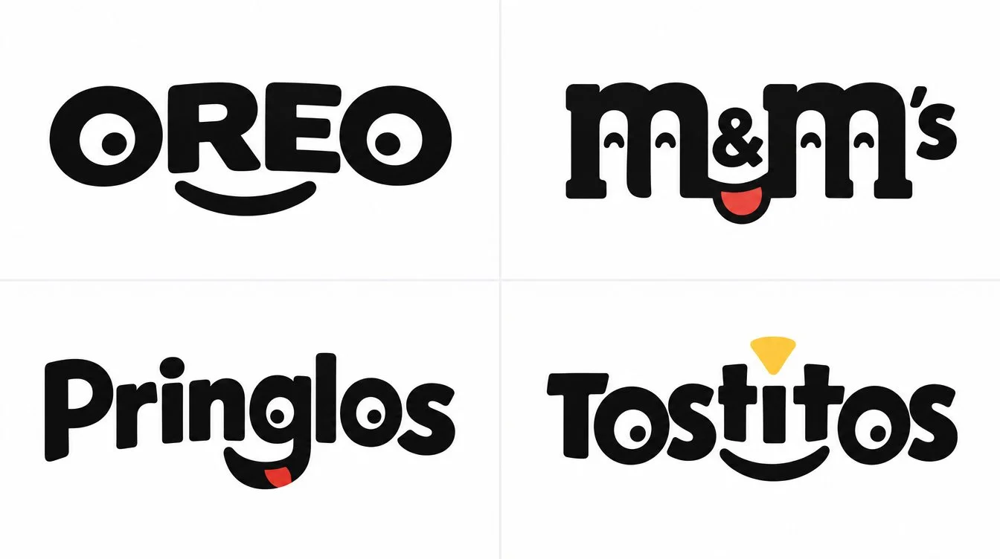

# Pareidolia Snack Wordmark 2x2 Grid (Code-Style Prompt)

**中文标题：** 拟人脸字标·零食2x2网格（代码式提示词）  
**ID:** `gi25-x-1375` · **Mode:** `generate`  
**Categories:** `poster-typography`, `ecommerce`  
**Tags:** `x-twitter`, `community`, `gpt-image-2.5`, `x-direct`, `en`



### Pareidolia Snack Wordmark 2x2 Grid (Code-Style Prompt)

```text
2x2 grid, 16:9, do this for 4 famous snacks: class Pareidolia_Logo:
    def __init__(self, word="[WORD]", emotion="[EMOTION: joyful, curious, sleepy...]"):
        self.word, self.emotion = word, emotion
        self.palette = "Black type on white, AI_INFER(one accent) for a single feature"

    def build(self):
        return [
            f"'{self.word}' in rounded bold sans-serif with no added drawings.",
            f"The letters' existing shapes form a {self.emotion} face: counters (o, e, a) read as eyes, and a curved letter or underline reads as the mouth.",
            "The face appears only through letter choice, spacing and slight tweaks to the glyphs.",
            "One feature, such as a cheek dot or tongue, is the accent color.",
        ]
# RENDER: flat vector wordmark. NO cartoon additions, NO outlines, NO mascot.
```

- **Recommended model:** `gpt-image-2.5-sunburst`
- **Settings:** _(defaults)_
- **Source:** [community](https://x.com/Gdgtify/status/2117663848228348294) — @Gdgtify
- **License note:** Original public X post; quoted with attribution — remix with attribution
- **Notes:** Collected directly from X; original post https://x.com/Gdgtify/status/2117663848228348294; post text names GPT Image 2.5; discovered via X search, prompt re-verified against the original X post via api.fxtwitter.com; verified=True; code-style (Python class) prompt
- **Preview:** `previews/gi25-x-1375.webp`
