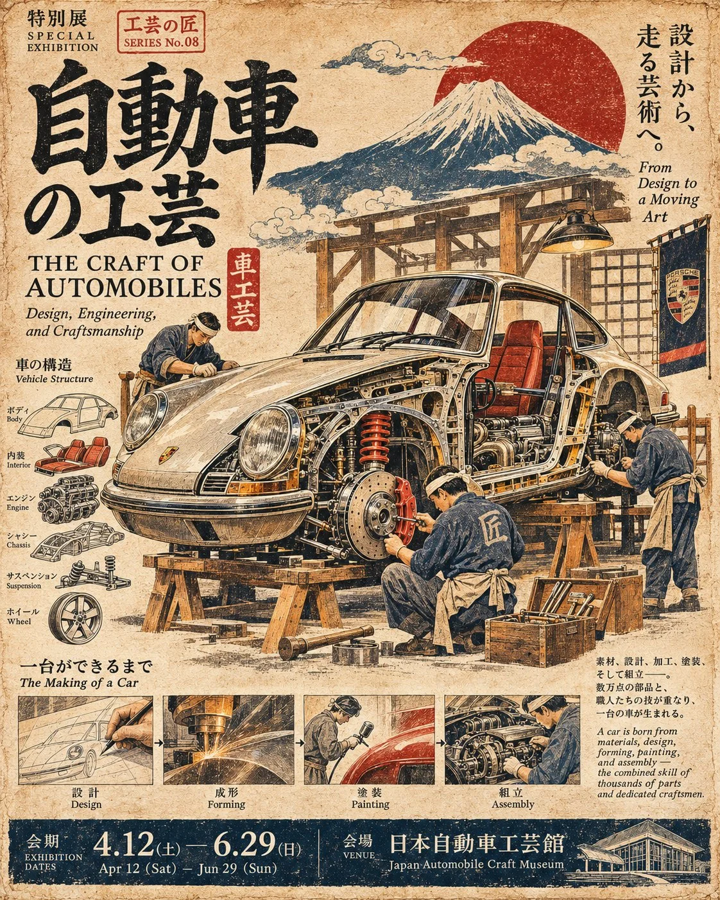

# Japanese Vintage Craft Art Poster (Universal Template)

**中文标题：** 日式复古工艺艺术海报（通用模板）  
**ID:** `gi25-x-1378` · **Mode:** `generate`  
**Categories:** `poster-typography`  
**Tags:** `x-twitter`, `community`, `gpt-image-2.5`, `x-direct`, `en`



### Japanese Vintage Craft Art Poster (Universal Template)

```text
JAPANESE VINTAGE CRAFT ART POSTER — UNIVERSAL PROMPT

Poster Theme: [Enter Theme]
Core Object or Material: [Enter Main Subject]
Craftsmanship or Transformation Process: [Enter Process]
Key Visual Details: [Enter Tools, Textures, or Figures]
Main Title: [Enter Title]
Primary Color Palette: [Enter Color Scheme]
Exhibition Information: [Enter Date, Location, etc.]

Create a sophisticated 4:5 vertical Japanese vintage craft art poster, transforming time, material structures, and traditional craftsmanship into a visually compelling narrative. Blend the aesthetics of traditional Japanese woodblock prints, contemporary editorial typography, and archival museum exhibition design.

HERO SUBJECT: Dramatically enlarge the central object or material, revealing its internal structure, surface textures, handcrafted details, manufacturing stages, or restoration marks. Give the subject a distinctive silhouette, intricate details, and authentic material characteristics. It must dominate the composition.

CRAFTSMANSHIP NARRATIVE: Introduce miniature human figures, traditional tools, specialized equipment, and realistic working scenes relevant to the selected craft. Use dramatic differences in scale between the central subject and supporting elements to communicate the complexity, precision, and hidden stories behind the process.

COMPOSITION: Incorporate sectional cutaways, layered structures, angled perspectives, suspended components, and interwoven materials. Every visual element must contribute to the same central craftsmanship narrative, creating a coherent visual story rather than an arbitrary collection of objects.

MATERIALS & PRINT TEXTURE: Use an aged ivory paper background, a restrained high-contrast vintage color palette, expressive hand-drawn lines, naturally distressed ink, subtle paper fibers, and authentic woodblock printing grain. Accurately reproduce the physical characteristics of each material, including oxidized metal, natural stone layers, rough ceramic surfaces, or intricate textile fibers.

TYPOGRAPHY & EDITORIAL LAYOUT: Feature an oversized Japanese or Chinese headline, complemented by an English exhibition title, small technical annotations, archival numbering, material descriptions, and concise explanatory text. Use sophisticated Japanese editorial typography with carefully balanced hierarchy and grid-based composition. Integrate typography naturally around the subject without obscuring important visual details.

FINAL PRESENTATION: Produce a museum-quality Japanese vintage craftsmanship exhibition poster combining striking visual impact, material authenticity, cultural depth, and refined editorial aesthetics.

OUTPUT REQUIREMENTS: Precise 4:5 vertical aspect ratio, dominant central subject, exceptional detail, balanced visual hierarchy, restrained colors, authentic traditional printmaking texture, and professional exhibition-grade art direction.

Avoid inaccurate material representations, unrelated craftsmanship techniques, artificial-looking structures, cluttered typography, and unnecessary decorative elements.
```

- **Recommended model:** `gpt-image-2.5-sunburst`
- **Settings:** _(defaults)_
- **Source:** [community](https://x.com/Goodmanprotocol/status/2117626645402280338) — @Goodmanprotocol
- **License note:** Original public X post; quoted with attribution — remix with attribution
- **Notes:** Collected directly from X; original post https://x.com/Goodmanprotocol/status/2117626645402280338; post text names GPT Image 2.5; discovered via X search, prompt re-verified against the original X post via api.fxtwitter.com; verified=True; fill-in-the-blank template
- **Preview:** `previews/gi25-x-1378.webp`
