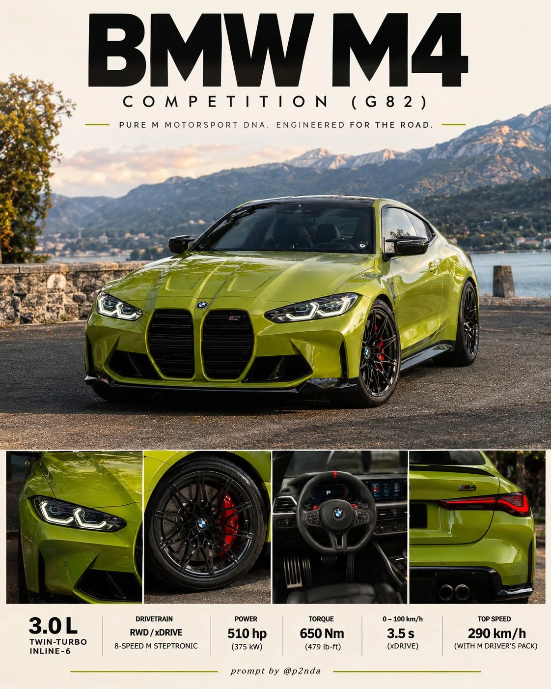

# Premium Automotive Collector's Editorial Poster

**中文标题：** 高级汽车收藏家编辑海报  
**ID:** `gi25-x-1383` · **Mode:** `generate`  
**Categories:** `poster-typography`, `ecommerce`  
**Tags:** `x-twitter`, `community`, `gpt-image-2.5`, `x-direct`, `en`



### Premium Automotive Collector's Editorial Poster

```text
PREMIUM AUTOMOTIVE COLLECTOR'S EDITORIAL POSTER

Create a photorealistic automotive collector's poster featuring an authentic [VEHICLE] in [COLOR]. Accurately preserve its original generation, factory design, proportions, headlights, grille, wheels, badges, trim, and specifications. No fictional modifications.

HERO IMAGE: Dramatic low-angle front three-quarter photograph showing the entire vehicle at [LOCATION]. Create an immersive, location-specific environment with recognizable architecture, realistic textures, cinematic lighting, natural reflections, and professional automotive photography.

HEADER: Large, bold black geometric sans-serif title "[NAME]" at the top, with 8% safe margins. Below it, add a short uppercase tagline reflecting the vehicle's heritage, framed by thin accent lines matching its body color.

DETAIL PANELS: Four equally aligned photographic panels across the bottom, featuring the same vehicle:

1. Front headlights and grille.
2. Wheels, tires, and brakes.
3. Original cockpit and instrumentation.
4. Rear design and taillights.

Use thin ivory dividers and consistent photographic quality.

SPECIFICATIONS: Add one elegant technical caption beneath the panels featuring verified engine, drivetrain, transmission, and performance details. Never invent specifications.

ART DIRECTION: Refined Swiss editorial grid, sophisticated typography, cream and ivory accents, elegant negative space, authentic materials, precise alignment, and premium collector's catalogue aesthetics.

FINAL REQUIREMENTS: Vertical 4:5, ultra-high resolution, exceptional photorealism, consistent vehicle identity across all five photographs, and professional print-ready quality. No watermark, signature, or unwanted text.
```

- **Recommended model:** `gpt-image-2.5-sunburst`
- **Settings:** _(defaults)_
- **Source:** [community](https://x.com/Goodmanprotocol/status/2117586448883023999) — @Goodmanprotocol
- **License note:** Original public X post; quoted with attribution — remix with attribution
- **Notes:** Collected directly from X; original post https://x.com/Goodmanprotocol/status/2117586448883023999; post text names GPT Image 2.5; discovered via X search, prompt re-verified against the original X post via api.fxtwitter.com; verified=True; fill-in template for [VEHICLE]
- **Preview:** `previews/gi25-x-1383.webp`
