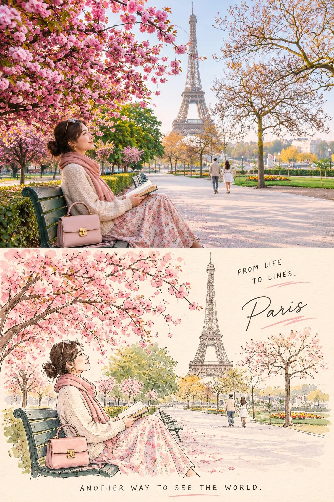

# Two-Part Travel-Art Poster: Real Photo Above, Art Below (2:3)

**中文标题：** 上下两段旅行艺术海报·实拍与艺术（2:3）  
**ID:** `gi25-x-1392` · **Mode:** `generate`  
**Categories:** `poster-typography`  
**Tags:** `x-twitter`, `community`, `gpt-image-2.5`, `x-direct`, `en`



### Two-Part Travel-Art Poster: Real Photo Above, Art Below (2:3)

```text
Create an exceptionally beautiful vertical 2:3 travel-art poster featuring [COUNTRY / CITY / LANDMARK], divided into two seamlessly connected horizontal sections.

UPPER HALF — THE REAL WORLD

Create a stunning, photorealistic lifestyle travel photograph of a young woman exploring or enjoying the destination.

Dress her in an elegant, destination-inspired outfit with soft, coordinated colours.
Give her a natural, relaxed pose, as if captured during a beautiful travel moment.
Surround her with the authentic scenery, architecture, landscape and cultural details of [DESTINATION].
Include subtle travel accessories such as a handbag, camera, flowers or a book.
Use beautiful natural daylight, soft cinematic colours and professional editorial photography.
Make the environment instantly recognisable as the chosen destination.

LOWER HALF — THE ART WORLD

Transform the exact same scene into a delicate, hand-drawn illustration.

Preserve the woman’s pose, hairstyle, outfit, accessories and overall composition.
Recreate the destination’s architecture and surroundings using elegant fine-line pencil and ink illustration.
Use warm ivory paper as the background.
Add subtle pastel colouring to selected details.
Maintain charming, imperfect hand-drawn strokes and a sophisticated sketchbook aesthetic.
Make the illustration feel like a page from a beautiful artist’s travel journal.

TYPOGRAPHY & DESIGN

Top or bottom corner: “FROM LIFE TO LINES.”

Add the destination’s name in elegant, understated handwritten typography.

At the bottom: “ANOTHER WAY TO SEE THE WORLD.”

OVERALL AESTHETIC

Premium Japanese lifestyle magazine meets European travel sketchbook. Dreamy, delicate, artistic, sophisticated and nostalgic.

The two sections must feel like the same magical moment captured in two different artistic worlds.

No visible borders, no watermarks, no creator signature, no unnecessary text. High-resolution, beautifully balanced composition.
```

- **Recommended model:** `gpt-image-2.5-sunburst`
- **Settings:** _(defaults)_
- **Source:** [community](https://x.com/Naiknelofar788/status/2117915180210565557) — @Naiknelofar788
- **License note:** Original public X post; quoted with attribution — remix with attribution
- **Notes:** Collected directly from X; original post https://x.com/Naiknelofar788/status/2117915180210565557; post text names GPT Image 2.5; discovered via X search, prompt re-verified against the original X post via api.fxtwitter.com; verified=True; fill-in template for [COUNTRY / CITY / LANDMARK]
- **Preview:** `previews/gi25-x-1392.webp`
