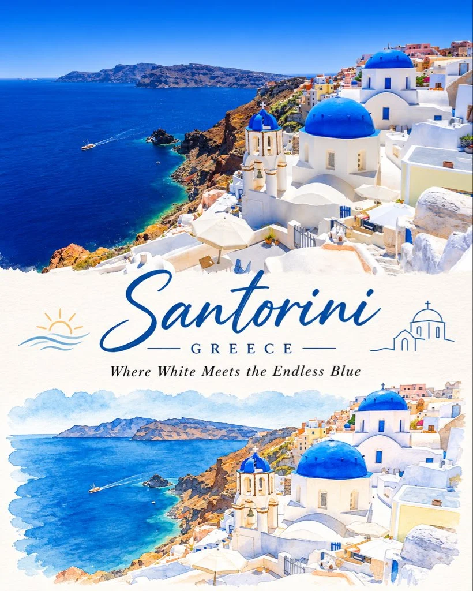

# Two-Part Travel-Art Collage Poster with Title & Tagline (4:5)

**中文标题：** 两段式旅行艺术拼贴海报·标题与标语（4:5）  
**ID:** `gi25-x-1393` · **Mode:** `generate`  
**Categories:** `poster-typography`  
**Tags:** `x-twitter`, `community`, `gpt-image-2.5`, `x-direct`, `en`



### Two-Part Travel-Art Collage Poster with Title & Tagline (4:5)

```text
Create an exceptionally beautiful vertical 4:5 travel-art poster featuring [CITY / COUNTRY / LANDMARK], presented as a sophisticated two-part visual collage.

The composition must have two distinct but harmoniously connected sections.

TOP SECTION — THE REAL WORLD

Use the actual destination as the primary visual reference.

Create a breathtaking photorealistic travel photograph of [DESTINATION].
Preserve its recognizable architecture, landscape, landmarks and geographical identity.
Capture beautiful natural lighting, realistic colours and atmospheric depth.
Include a few subtle human elements, boats, streets or local details where appropriate.
Keep the composition cinematic, clean and visually immersive.

This section should feel like a photograph taken during a beautiful journey.

MIDDLE SECTION — THE EDITORIAL TRANSITION

Create an elegant transition between photography and illustration.

Add the destination name in beautiful, sophisticated typography.
Include the country name in small uppercase lettering.
Add a short poetic travel-inspired tagline.
Use delicate hand-drawn decorative elements, tiny botanical details or a minimal location emblem.
Maintain generous white space and a refined editorial layout.

BOTTOM SECTION — THE WORLD REIMAGINED AS ART

Transform the same destination into a beautiful minimalist hand-painted illustration.

Recreate the recognizable landmark or scenery from the upper photograph.
Use delicate watercolor washes, expressive gouache brushwork and subtle ink outlines.
Simplify the architecture and surroundings into an elegant artistic composition.
Retain the destination’s signature colours, shapes and distinctive features.
Add a few charming details such as tiny boats, flowering branches, little figures, birds or local elements.
Use soft pastel shades, muted colours and carefully placed vibrant accents.
Allow some watercolor textures and painted edges to fade naturally into the white background.

The lower illustration must be an artistic interpretation of the SAME location shown above, not an unrelated scene.

ART DIRECTION

Premium illustrated travel magazine aesthetic.
Contemporary minimalist editorial design.
Beautiful balance between photography and fine art.
Delicate watercolor and mixed-media textures.
Sophisticated typography and generous negative space.
Soft, harmonious colour palette.
Elegant, clean and collectible poster appearance.

FINAL COMPOSITION

Vertical 4:5 poster.
Upper half: approximately 50% photorealistic destination photography.
Lower half: approximately 50% minimalist watercolor illustration.
A subtle, elegant transition between both worlds.
Destination name clearly visible and beautifully typeset.
No creator watermark, no unnecessary text, no clutter.

DESTINATION TITLE: [CITY / LANDMARK]

COUNTRY: [COUNTRY]

TAGLINE: [SHORT POETIC TRAVEL QUOTE]

The final artwork should communicate one beautiful idea: experience the destination in reality above, then discover its artistic soul below.
```

- **Recommended model:** `gpt-image-2.5-sunburst`
- **Settings:** _(defaults)_
- **Source:** [community](https://x.com/Naiknelofar788/status/2118196113828438249) — @Naiknelofar788
- **License note:** Original public X post; quoted with attribution — remix with attribution
- **Notes:** Collected directly from X; original post https://x.com/Naiknelofar788/status/2118196113828438249; post text names GPT Image 2.5; discovered via X search, prompt re-verified against the original X post via api.fxtwitter.com; verified=True; fill-in template for city, country and tagline
- **Preview:** `previews/gi25-x-1393.webp`
