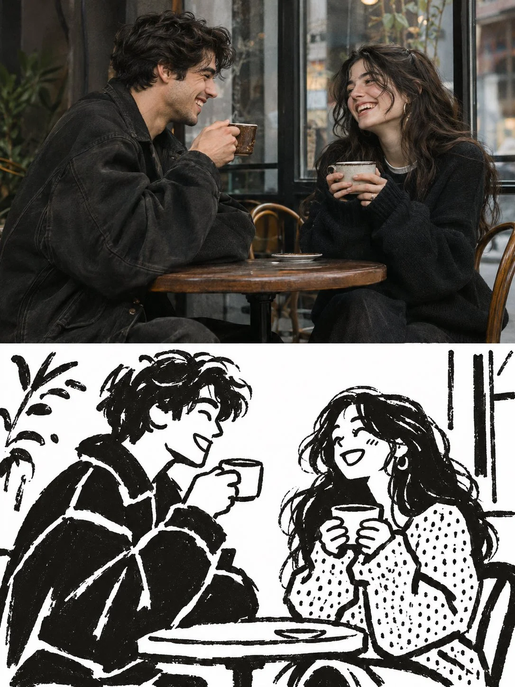

# 50/50 Editorial Poster: Photo over Hand-Drawn Screen Print

**中文标题：** 五五分编辑海报·实拍与手绘丝网印  
**ID:** `gi25-x-1394` · **Mode:** `generate`  
**Categories:** `poster-typography`  
**Tags:** `x-twitter`, `community`, `gpt-image-2.5`, `x-direct`, `en`



### 50/50 Editorial Poster: Photo over Hand-Drawn Screen Print

```text
Create a premium, full-bleed 3:4 vertical editorial art poster featuring an original, charming everyday-life scene, presented in an artistic 50/50 split composition.

COMPOSITION — EXACTLY TWO EQUAL HORIZONTAL HALVES

Divide the entire canvas into two perfectly equal horizontal sections, with no border, divider, frame, text, or labels.

TOP HALF — ORIGINAL EDITORIAL SCENE

Create a visually captivating, naturally expressive scene featuring two stylish young adults enjoying a spontaneous everyday moment together in a charming urban café.

The young man has distinctive tousled dark hair, an attractive expressive face, and wears a relaxed oversized dark jacket. The young woman has long, voluminous dark hair, delicate facial features, and wears a stylish contemporary outfit. They sit opposite each other at a small café table, sharing a spontaneous laugh while holding coffee cups.

Include a few carefully selected environmental details, such as a small table, two coffee cups, a chair, and a simple café window. Capture a genuine candid interaction with natural body language, charming expressions, and an intimate atmosphere.

Render this upper section as an authentic, beautifully composed editorial photograph with natural skin textures, realistic proportions, subtle film grain, soft ambient daylight, rich natural contrast, and sophisticated magazine photography aesthetics.

BOTTOM HALF — HAND-DRAWN SCREEN-PRINT INTERPRETATION

Recreate the exact same café scene, characters, clothing, hairstyles, poses, expressions, objects, and interactions as a playful, minimalist, hand-inked illustration.

Use STRICTLY TWO COLORS:

Pure white (#FFFFFF) background.
Near-black (#080807) ink for all outlines, characters, and solid shapes.

The illustration should resemble an imperfect handmade screen print drawn with thick black paint markers and expressive ink brushes.

Character design:

Rounded, slightly irregular heads.
Simple expressive eyes and minimal facial features.
Friendly, exaggerated smiles.
Chunky, imperfect silhouettes.
Oversized simplified clothing shapes.
Rounded mitten-like hands.
Bold, organic body proportions.
Distinctive hairstyles that make both characters recognizable.

Use broad, confident, imperfect brush strokes with visible hand-drawn wobble, irregular contours, and natural variations in stroke thickness.

Reduce unnecessary environmental details by approximately 80%. Retain only the essential café table, coffee cups, chairs, and a few recognizable background elements.

Introduce a small patch of dense, irregular black dots on one garment to create a traditional hand-printed texture.

Allow generous white negative space. Keep the artwork flat, playful, spontaneous, expressive, and unmistakably handmade.

ART DIRECTION

The final result should feel like a sophisticated independent art magazine cover, combining documentary-style photography with a whimsical underground illustration aesthetic.

The photographic half must look genuinely photographic. The illustrated half must look genuinely hand-drawn.

Both halves must depict precisely the same original scene, with matching composition, character placement, clothing, gestures, and objects.

STRICT RESTRICTIONS

No additional colors in the illustration. No gray, gradients, shadows, 3D effects, realistic shading, vector graphics, thin outlines, geometric perfection, excessive details, or corporate icon aesthetics.

No extra characters, unrelated objects, text, typography, letters, numbers, logos, signatures, watermarks, borders, or decorative frames.

FINAL OUTPUT

Vertical 3:4 aspect ratio. Full-bleed premium editorial poster. Exactly 50% authentic photographic scene on top and 50% matching black-and-white hand-drawn screen-print illustration on the bottom.

The result should look like a carefully art-directed, collectible contemporary editorial art print.
```

- **Recommended model:** `gpt-image-2.5-sunburst`
- **Settings:** _(defaults)_
- **Source:** [community](https://x.com/j_smeaton99/status/2117915494112174586) — @j_smeaton99
- **License note:** Original public X post; quoted with attribution — remix with attribution
- **Notes:** Collected directly from X; original post https://x.com/j_smeaton99/status/2117915494112174586; post text names GPT Image 2.5; discovered via X search, prompt re-verified against the original X post via api.fxtwitter.com; verified=True
- **Preview:** `previews/gi25-x-1394.webp`
