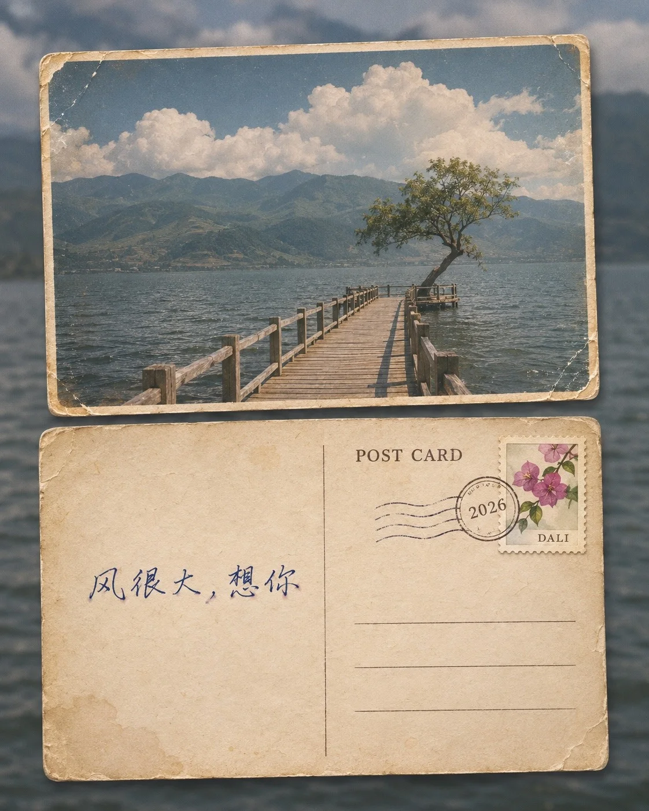

# Vintage Postcard Front & Back with Stamp and Postmark

**中文标题：** 复古明信片正反面·邮票与邮戳  
**ID:** `gi25-x-1395` · **Mode:** `generate`  
**Categories:** `poster-typography`, `general`  
**Tags:** `x-twitter`, `community`, `gpt-image-2.5`, `x-direct`, `zh`



### Vintage Postcard Front & Back with Stamp and Postmark

```text
Create an image with the following visual system. Replace the subject as specified.

Visual system (light, color, composition, medium, mood):
一张竖幅约 4:5 的复古明信片展示图。背景是一张铺满画面的当地风景照片，略微失焦、偏暗、低饱和，只作环境底图。前景上下叠放同一张明信片的正面和背面，各占画面宽度约四分之三，横向放置，彼此轻微错位，边缘落下细软的投影。上方正面是一张带白色窄边框的彩色风景照片，色彩偏旧、轻微褪色并带胶片颗粒，四角磨损、发黄、有细小折痕。下方背面是做旧的米黄色卡纸，纸面有淡淡的水渍斑、细小纤维和磨白的边角；中间一条细竖线分隔，左侧是手写留言区，右侧上方是细小的衬线体印刷标题，右上角贴一枚带齿孔的原创小插画邮票，邮票上压着一个圆形邮戳和几道波浪消印线，右下是几条空着的细地址横线。手写字用深蓝墨水钢笔书写，笔画有轻微洇墨。光线是柔和均匀的漫射日光，略偏暖，纸面没有强反光。配色由底图的环境色、旧纸米黄、深蓝墨水和邮票上的一两个小色块组成。图上只出现 New subject 里写明的文字，每一处都要拼写准确、只出现一次，其余位置留白或只有空横线，不出现真实品牌、卡通形象或其他文字。安静、私人，像一张从旅途中寄回来的纪念。

New subject:
正面照片：高原湖边一条长长的木栈道伸进湖里，尽头一棵歪着长的小树，远处是连绵的青山和大朵白云。背景底图：失焦的湖面和远山。邮票图案：一枝粉紫色的三角梅。图上文字只有四处：背面右上的印刷标题「POST CARD」；邮票底部小字「DALI」；邮戳圆圈里「2026」；左侧留言区一行手写中文「风很大，想你」。除此以外没有任何文字、品牌或标志。
```

- **Recommended model:** `gpt-image-2.5-sunburst`
- **Settings:** _(defaults)_
- **Source:** [community](https://x.com/static_stare/status/2117917507352727843) — @static_stare
- **License note:** Original public X post; quoted with attribution — remix with attribution
- **Notes:** Collected directly from X; original post https://x.com/static_stare/status/2117917507352727843; post text names GPT Image 2.5; discovered via X search, prompt re-verified against the original X post via api.fxtwitter.com; verified=True; prompt for image 1 of 4 (the author shares the other three on request); preview is image 1
- **Preview:** `previews/gi25-x-1395.webp`
