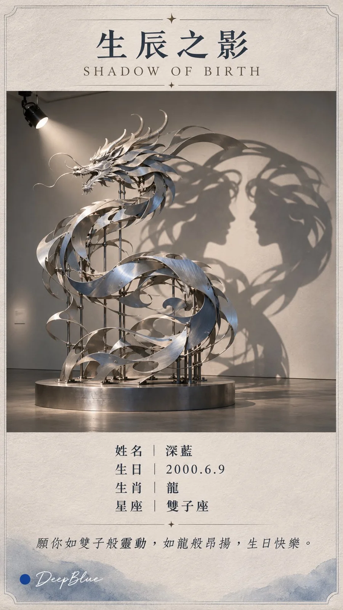

# Zodiac × Constellation Shadow Sculpture Birthday Card

**中文标题：** 生肖×星座影子雕塑生日纪念卡  
**ID:** `gi25-x-1402` · **Mode:** `generate`  
**Categories:** `poster-typography`  
**Tags:** `x-twitter`, `community`, `gpt-image-2.5`, `x-direct`, `zh`



### Zodiac × Constellation Shadow Sculpture Birthday Card

```text
《生辰之影》SHADOW OF BIRTH

專屬信息
姓名：【填寫姓名】
生日：【YYYY .MM. DD】
生肖：【填寫生肖】
星座：【填寫星座】

東方生肖 × 西方星座 × 影子雕塑 × 生日紀念卡

根據填寫的信息，創作一張專屬生日藝術收藏卡。

生肖決定雕塑的實體形態，保留清晰可辨的輪廓與關鍵特徵。雕塑由不同深度的金屬曲面、彎曲薄片和鏤空構件組成，具有真實的連接與支撐結構。

星座決定雕塑的隱藏投影。一盞定向聚光燈照射雕塑，構件沿光線方向重疊，在後方牆面形成該星座的代表形象。雕塑與投影來自同一套三維結構，光照方向、遮擋關係與投影尺度自然可信。

根據生肖與星座自由設計雕塑材質、色彩、姿態和展廳環境，讓實體與投影都清晰可辨。

採用當代美術館典藏卡的設計語言，融合真實展覽攝影、克制配色、精緻字體與細膩紙張質感。

卡片上方排列標題：

「生辰之影」
SHADOW OF BIRTH

中央完整呈現一件生肖雕塑及其星座投影，兩者同等重要，留白自然。

卡片下方清晰、準確地排列所填寫的姓名、生日、生肖與星座。

結合生肖寓意與星座特質，自動創作一句簡短、溫暖的生日祝福，排列在個人信息下方。每張獨立創作，讓兩種意象自然呼應。

一張卡片，一件雕塑，一組投影，一個完整畫面。

9:16 竪版。

n=3，代表系列計劃數量，每次生成一張完整獨立單圖，不拼圖。

左下簽名：深藍色實心圓點在前，白色手寫體 DeepBlue 在後
```

- **Recommended model:** `gpt-image-2.5-sunburst`
- **Settings:** _(defaults)_
- **Source:** [community](https://x.com/DeepBlueX0/status/2117965580917678289) — @DeepBlueX0
- **License note:** Original public X post; quoted with attribution — remix with attribution
- **Notes:** Collected directly from X; original post https://x.com/DeepBlueX0/status/2117965580917678289; post text names GPT Image 2.5; discovered via X search, prompt re-verified against the original X post via api.fxtwitter.com; verified=True; fill-in template for name, birthday, zodiac and constellation; preview is image 1
- **Preview:** `previews/gi25-x-1402.webp`
