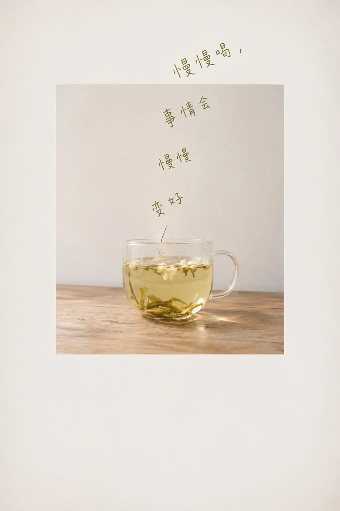

# Handwritten Words Rising Like Steam from an Everyday Object

**中文标题：** 日常物件升起手写心事·静物  
**ID:** `gi25-x-1407` · **Mode:** `generate`  
**Categories:** `poster-typography`, `general`  
**Tags:** `x-twitter`, `community`, `gpt-image-2.5`, `x-direct`, `zh`



### Handwritten Words Rising Like Steam from an Everyday Object

```text
一张安静的竖版静物图，第一眼撞上来的是一段手写的话像热气一样从一件东西里升起来：画面中央嵌着一张竖长方形的实拍照片，照片里只有主题里那一件日常物件，孤零零地放在一块朴素的台面上，背后是一整面干净的浅色墙，物件落在照片的下半部，头顶留出大片空墙；从物件的顶端开始，一串手写的小字一行行往上冒，每行都很短，居中排开，行与行之间微微错位、轻轻歪斜，整列字像一缕被风吹弯的烟，越往上越散、越往一侧偏，最后穿过照片的上沿，继续写进照片外面的空白里，这段从照片里升出框外的字就是全图的心事。照片外面的底色和照片里的墙几乎是同一种浅色，只差一点明度，让照片的边框若有若无地浮在纸上；画面四角柔和地暗下去，把视线收向中间。照片是自然窗光下的随手拍，光从一侧来，台面的木纹和物件的透明或反光都照实保留，阴影短而轻，物件顶端受光最亮的那一点正好托住字的起点，字从光里冒出来。颜色由主题决定：照片保留主题物件和台面本来的颜色；手写字的颜色直接取那件物件身上最浓的那一种颜色，略微调暗，像用它蘸着写的，是照片之外唯一的颜色；底色是比墙更浅一点的同一种浅色。主题物件换了，字色就跟着换，只守住浅底、一件物件、一缕同色的字这层关系。字用一支细笔随手写成，遇到拉丁字母时大小写混着，字形松而略带孩子气，笔画粗细一致，不连笔；写的是主题带来的那段话，没有给出时，就写几句关于等待、停留或出发的心里话，整段读起来像自言自语，中文一律用简体。照片占画面中部偏上，四周留出宽阔的空白，下方比上方留得更多。整张图安静、慢，像一个人对着一杯东西发了很久的呆，心里的话就自己飘了出来。
```

- **Recommended model:** `gpt-image-2.5-sunburst`
- **Settings:** _(defaults)_
- **Source:** [community](https://x.com/xiaoxiaodong/status/2117972457407779231) — @xiaoxiaodong
- **License note:** Original public X post; quoted with attribution — remix with attribution
- **Notes:** Collected directly from X; original post https://x.com/xiaoxiaodong/status/2117972457407779231; post text names GPT Image 2.5; discovered via X search, prompt re-verified against the original X post via api.fxtwitter.com; verified=True; prompt written with Opus 5.5 for GPT-image2.5; theme object is a variable
- **Preview:** `previews/gi25-x-1407.webp`
