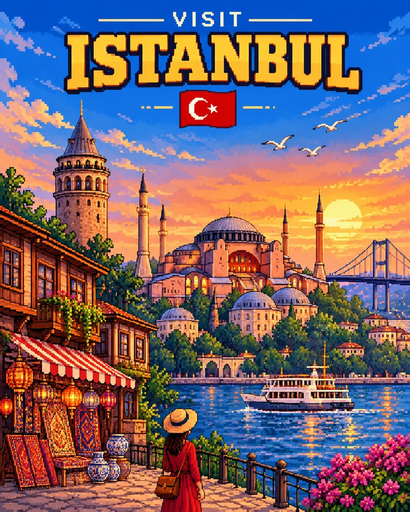

# South American Pixel-Art Travel Poster (4:5)

**中文标题：** 南美像素风旅行海报（4:5）  
**ID:** `gi25-x-1421` · **Mode:** `generate`  
**Categories:** `poster-typography`, `general`  
**Tags:** `x-twitter`, `community`, `gpt-image-2.5`, `x-direct`, `en`



### South American Pixel-Art Travel Poster (4:5)

```text
SOUTH AMERICAN PIXEL-ART TRAVEL POSTER

Create a visually stunning, highly detailed retro pixel-art travel poster in a vertical 4:5 aspect ratio, inspired by classic 16-bit and 32-bit video game aesthetics.

DESTINATION: [Insert City or Location]

DESIGN & COMPOSITION:
Create a beautiful, immersive pixel-art illustration showcasing the destination's most iconic landmarks, recognizable architecture, breathtaking landscapes, local culture, and distinctive atmosphere. Include authentic regional elements such as native plants, flowers, local people, traditional clothing, wildlife, streets, beaches, mountains, or other recognizable features relevant to the destination.

TYPOGRAPHY & LAYOUT:

- At the top, display the word "VISIT" in small, elegant, retro pixel typography.
- Below it, prominently feature the destination's name in large, bold, decorative pixel-art lettering.
- Include the destination's authentic national flag directly beneath the name.
- Make all typography clean, correctly spelled, legible, and beautifully integrated into the composition.

ART STYLE:
Use authentic high-quality pixel art with crisp square pixels, intricate pixel shading, rich saturated colors, beautiful lighting, atmospheric depth, and carefully crafted details. Aim for the visual quality of a premium retro video game environment.

COLOR & ATMOSPHERE:
Use vibrant blues, lush greens, warm sunlight, colorful architectural details, and striking natural contrasts. Create an inviting, adventurous, nostalgic travel-poster atmosphere.

IMPORTANT REQUIREMENTS:

- Accurately represent the selected destination and its recognizable landmarks.
- Use the correct national flag.
- Make every poster visually unique according to its destination.
- Maintain consistent typography, composition, and artistic style across different destinations.
- One destination per poster. Never combine multiple locations.
- No watermarks, signatures, borders, or unnecessary text.

FINAL RESULT: A premium, eye-catching retro pixel-art tourism poster that looks like an authentic collectible travel advertisement from a beautifully imagined 16-bit adventure game.
```

- **Recommended model:** `gpt-image-2.5-sunburst`
- **Settings:** _(defaults)_
- **Source:** [community](https://x.com/Goodmanprotocol/status/2118331793845969031) — @Goodmanprotocol
- **License note:** Original public X post; quoted with attribution — remix with attribution
- **Notes:** Collected directly from X; original post https://x.com/Goodmanprotocol/status/2118331793845969031; post text names GPT Image 2.5; discovered via X search, prompt re-verified against the original X post via api.fxtwitter.com; verified=True; fill-in template for [Insert City or Location]
- **Preview:** `previews/gi25-x-1421.webp`
