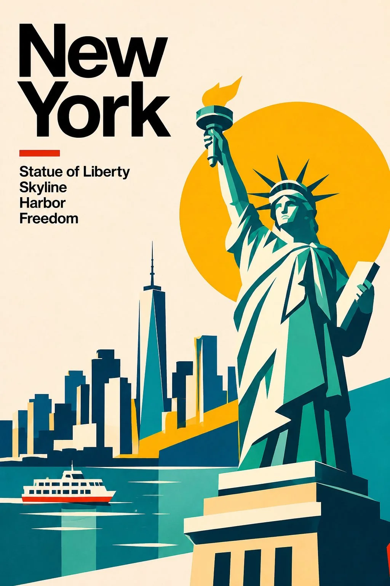

# DESTINATION IN SHAPES Minimalist Travel-Art Poster

**中文标题：** 「DESTINATION IN SHAPES」极简旅行艺术海报  
**ID:** `gi25-x-1422` · **Mode:** `generate`  
**Categories:** `poster-typography`  
**Tags:** `x-twitter`, `community`, `gpt-image-2.5`, `x-direct`, `en`



### DESTINATION IN SHAPES Minimalist Travel-Art Poster

```text
Create an exceptionally striking, premium minimalist travel-art poster featuring [COUNTRY / CITY / LANDMARK], designed as part of an exclusive international collection titled:

“DESTINATION IN SHAPES”

1. UNIQUE VISUAL IDENTITY

Transform the destination into a bold geometric landscape using simplified architectural forms, angular mountains, overlapping shapes, dramatic silhouettes and carefully composed negative space.

Capture the most recognisable visual identity of the destination without making it look like a conventional photograph.

2. DESTINATION-INSPIRED COLOUR PALETTE

Choose a distinctive colour combination inspired by the destination’s geography, culture, architecture and natural environment.

Every destination must have its own colour identity. Avoid repeating the same palette.

Examples:

* Japan — Vermilion red, warm ivory and deep charcoal.
* Italy — Mediterranean blue, lemon yellow and terracotta.
* Morocco — Burnt orange, desert sand and deep teal.
* Iceland — Glacier blue, icy white and volcanic black.
* India — Saffron, indigo and warm cream.
* Greece — Cobalt blue, white and soft coral.
* Switzerland — Royal blue, scarlet red and ivory.
* Egypt — Golden ochre, turquoise and midnight navy.

3. TYPOGRAPHY & LAYOUT

* Oversized, bold, modern sans-serif typography.
* Destination name prominently positioned at the top.
* Small elegant descriptive text underneath, featuring 3–4 destination-related keywords.
* A small geometric emblem or symbolic detail representing the destination.
* Strong editorial composition with generous negative space.
* A clean, sophisticated international travel-poster aesthetic.

4. SIGNATURE DETAILS

Include one small, distinctive visual element associated with the destination, such as a cable car, sailing boat, traditional doorway, rising sun, palm tree, train, bridge or architectural detail.

5. ART DIRECTION

* Flat vector-style geometric illustration.
* Bold silhouettes and crisp edges.
* Beautifully layered shapes.
* Subtle paper texture.
* Sophisticated colour blocking.
* Contemporary Swiss graphic design influence with an original artistic interpretation.

FINAL RESULT

A visually unforgettable, beautifully balanced, collectible travel poster. Minimal yet expressive, colourful yet sophisticated.

Portrait 2:3 composition. Ultra-clean professional graphic design.

Display only the destination name and short geographical descriptors. No artist signature, no watermark, no unnecessary text
```

- **Recommended model:** `gpt-image-2.5-sunburst`
- **Settings:** _(defaults)_
- **Source:** [community](https://x.com/Naiknelofar788/status/2118343023222214778) — @Naiknelofar788
- **License note:** Original public X post; quoted with attribution — remix with attribution
- **Notes:** Collected directly from X; original post https://x.com/Naiknelofar788/status/2118343023222214778; post text names GPT Image 2.5; discovered via X search, prompt re-verified against the original X post via api.fxtwitter.com; verified=True; fill-in template for [COUNTRY / CITY / LANDMARK]
- **Preview:** `previews/gi25-x-1422.webp`
