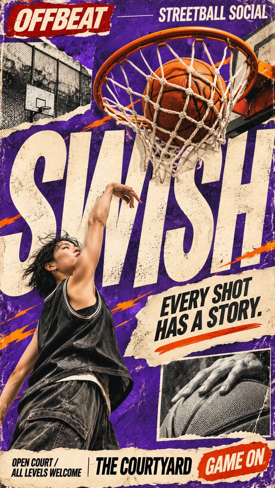

# Street-Culture Editorial Poster with Giant Type (9:16)

**中文标题：** 街头文化巨型字体编辑海报（9:16）  
**ID:** `gi25-x-1425` · **Mode:** `generate`  
**Categories:** `poster-typography`  
**Tags:** `x-twitter`, `community`, `gpt-image-2.5`, `x-direct`, `en`



### Street-Culture Editorial Poster with Giant Type (9:16)

```text
Create a high-impact 9:16 vertical street culture editorial poster.

Customize:
- Brand / Series: [BRAND NAME]
- Headline: [MAIN TITLE]
- Subject / Object: [PERSON / PRODUCT / OBJECT]
- Core Interaction: [OBJECT THROUGH TYPE / DISTORTED TYPE / REFLECTION / EXTREME PERSPECTIVE / LAYERED GROUP]
- Color Palette: [MAIN COLORS]
- Supporting Copy: [TAGLINE / EVENT / LOCATION]

Blend authentic photography, oversized experimental typography, 90s–2000s punk-zine aesthetics, grunge editorial design, and analog print collage.

Build the entire poster around one clear visual interaction between the real subject and giant typography. Let the object or person physically affect the layout through realistic occlusion, perspective, reflection, motion, distortion, or layered cutouts. The concept should be understandable at a glance while still creating a “how did they do that?” moment.

Use massive condensed sans-serif headlines, tight spacing, intentional cropping, asymmetric composition, and strong scale contrast. Typography should function as part of the image structure, not just sit behind the subject.

Add meaningful editorial details: small brand headers, short taglines, monochrome photo inserts, torn-paper panels, thin divider lines, labels, and compact information blocks. Keep the layout dense but organized, with one dominant focal point and clear visual hierarchy.

Use a bold limited palette with strong contrast, plus distressed ink, halftone dots, photocopy grain, subtle print misregistration, rough paper fibers, and authentic collage edges. Keep faces, hands, clothing, products, and important objects photorealistic and structurally accurate.

The final result should feel like a professionally art-directed street culture poster with strong stop-scroll impact, tactile vintage print character, and rich editorial detail.

Avoid generic layouts, glossy CGI, 3D typography, plastic skin, meaningless filler text, excessive clutter, random logos, QR codes, numbering, and watermarks.
```

- **Recommended model:** `gpt-image-2.5-sunburst`
- **Settings:** _(defaults)_
- **Source:** [community](https://x.com/MrLarus/status/2118372757243338776) — @MrLarus
- **License note:** Original public X post; quoted with attribution — remix with attribution
- **Notes:** Collected directly from X; prompt posted as the author's own reply https://x.com/MrLarus/status/2118372757243338776 to https://x.com/MrLarus/status/2118372373087097285, which carries the images; GPT Image 2.5 is named in the parent post; discovered via X search, prompt re-verified against the original X post via api.fxtwitter.com; verified=True; fill-in template for brand, headline, subject and interaction; preview is image 1 of the parent post
- **Preview:** `previews/gi25-x-1425.webp`
