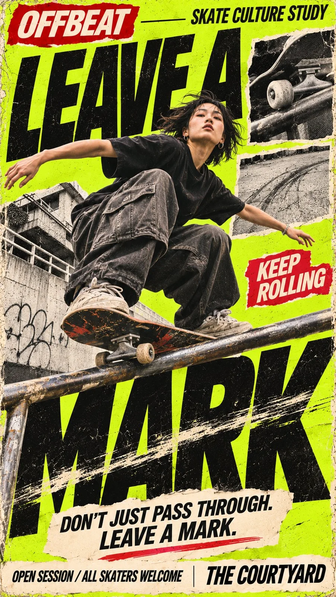

# Physical-Typography Street Poster (Fabric/Doors/Rain/Skate)

**中文标题：** 物理字体互动街头海报（织物/车门/雨/滑板）  
**ID:** `gi25-x-1427` · **Mode:** `generate`  
**Categories:** `poster-typography`  
**Tags:** `x-twitter`, `community`, `gpt-image-2.5`, `x-direct`, `en`



### Physical-Typography Street Poster (Fabric/Doors/Rain/Skate)

```text
Create a high-impact 9:16 vertical street culture editorial poster.

Customize:
- Brand / Series: [BRAND NAME]
- Main Headline: [MAIN TITLE]
- Subject: [PERSON / OUTFIT / OBJECT]
- Physical Interaction: [FABRIC FOLDS / SLIDING DOORS / WATER REFRACTION / SKATE FRICTION / OTHER]
- Main Colors: [COLOR PALETTE]
- Supporting Copy: [TAGLINE / EVENT INFO]

Visual Style

Blend authentic streetwear photography with oversized experimental typography, 90s–2000s punk zine aesthetics, grunge editorial design, screen printing, torn-paper collage, halftone textures, and analog print imperfections.

Physical Typography

The key idea is that the typography should physically interact with the real-world subject.

Let fabric folds bend printed letters, doors split a headline, rain or transparent surfaces refract type, rails and motion leave friction marks across letters, or another believable physical phenomenon directly change the typography.

The interaction must feel intentional and physically believable—not like a random digital effect. Keep the main headline large, bold, condensed, and clearly readable.

Composition

Use dramatic perspectives, asymmetrical layouts, strong foreground/background overlaps, and one dominant visual relationship.

Make the subject large enough to work at thumbnail size. Let photography, typography, and physical materials overlap through realistic occlusion and depth instead of simply placing text behind the subject.

Editorial Details

Add meaningful supporting copy, small editorial labels, monochrome photo inserts, thin divider lines, torn-paper elements, and compact information sections.

Keep the layout dense but organized, with a clear hierarchy from main visual → headline → supporting information.

Texture & Finish

Use bold contrasting colors, distressed ink, subtle print misregistration, photocopy grain, halftone dots, rough paper fibers, and tactile cutout edges.

Keep people, clothing, objects, and physical materials photorealistic with natural skin, realistic fabric, accurate anatomy, and believable lighting.

Final result: a polished, stop-scroll street culture poster where real materials and physical phenomena become part of the typography itself.

Avoid generic fashion layouts, glossy CGI, 3D text, meaningless filler text, excessive clutter, plastic skin, anatomy errors, fake QR codes, decorative numbering, and watermarks.
```

- **Recommended model:** `gpt-image-2.5-sunburst`
- **Settings:** _(defaults)_
- **Source:** [community](https://x.com/MrLarus/status/2118381337690399024) — @MrLarus
- **License note:** Original public X post; quoted with attribution — remix with attribution
- **Notes:** Collected directly from X; prompt posted as the author's own reply https://x.com/MrLarus/status/2118381337690399024 to https://x.com/MrLarus/status/2118381119896969699, which carries the images; GPT Image 2.5 is named in the parent post; discovered via X search, prompt re-verified against the original X post via api.fxtwitter.com; verified=True; fill-in template; preview is image 1 of the parent post
- **Preview:** `previews/gi25-x-1427.webp`
