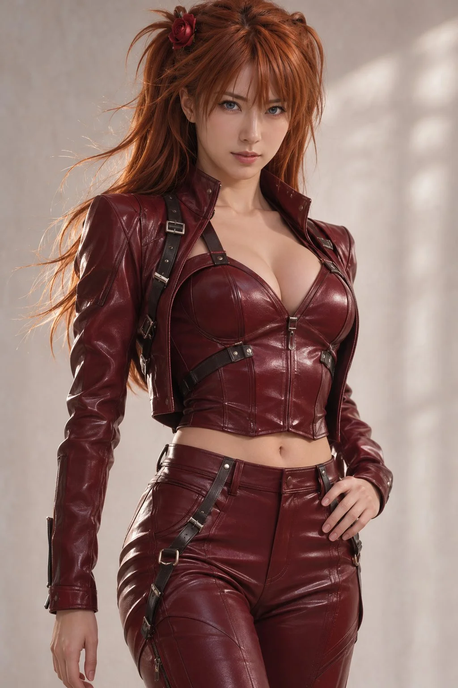

# Asuka-Inspired Hyper-Realistic Anime Fashion Poster

**中文标题：** 明日香启发·超写实动漫时尚海报  
**ID:** `gi25-x-1433` · **Mode:** `generate`  
**Categories:** `poster-typography`, `general`  
**Tags:** `x-twitter`, `community`, `gpt-image-2.5`, `x-direct`, `en`



### Asuka-Inspired Hyper-Realistic Anime Fashion Poster

```text
Ultra-realistic cinematic anime poster of a beautiful female assassin inspired by Asuka  from Neon Genesis Evangelion, standing in a dramatic frontal pose, intense light blue gray  eyes staring directly at camera, sleek auburn hair with soft wind-blown strands, elegant rose hair ornament, glossy dark red leather outfit with intricate straps, photorealistic skin texture with subtle glow, soft makeup, highly detailed fabric reflections and specular highlights, modern Japanese anime realism fusion style, luxury fashion-editorial composition, clean white studio background with faint texture and atmospheric particles, cinematic soft rim lighting, shallow depth of field, ultra-sharp focus on eyes and face, premium poster typography layout with large vertical serif text “ASUKA” on left side, minimalist graphic design, subtle Japanese text accents, emotional yet dangerous mood, volumetric lighting, high contrast, monochromatic auburn-black-red palette, hyper detailed digital painting, 8k, masterpiece quality, realistic anime fusion aesthetic, magazine cover composition, vertical poster format.
```

- **Recommended model:** `gpt-image-2.5-sunburst`
- **Settings:** _(defaults)_
- **Source:** [community](https://x.com/tealdog2/status/2118561015407505412) — @tealdog2
- **License note:** Original public X post; quoted with attribution — remix with attribution
- **Notes:** Collected directly from X; original post https://x.com/tealdog2/status/2118561015407505412; post text names GPT Image 2.5; discovered via X search, prompt re-verified against the original X post via api.fxtwitter.com; verified=True; comparison post across Grok Imagine / GPT Image 2 / GPT Image 2.5; preview is image 4, the GPT Image 2.5 result (poster wording removed)
- **Preview:** `previews/gi25-x-1433.webp`
