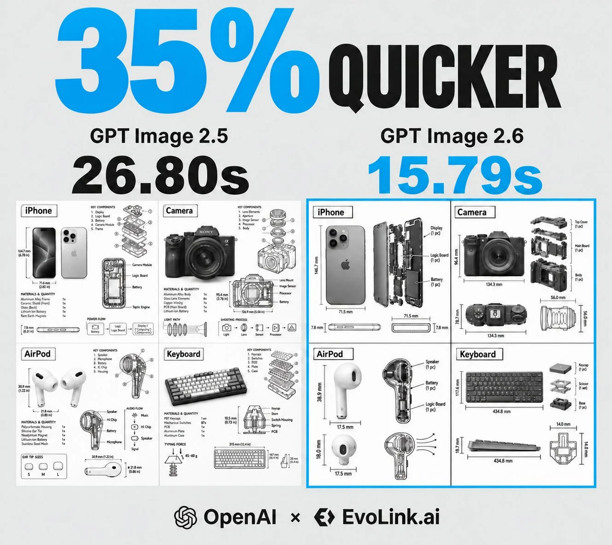

# Monochrome 2×2 Technical Product Infographic

**中文标题：** 单色 2×2 产品技术信息图  
**ID:** `gi25-x-1456` · **Mode:** `generate`  
**Categories:** `poster-typography`  
**Tags:** `x-twitter`, `community`, `gpt-image-2.5`, `x-direct`, `en`



### Monochrome 2×2 Technical Product Infographic

```text
Create one square monochrome technical infographic on a pure white background, divided into an even 2×2 grid with balanced negative space and thin black separators.

The four subjects and the ONLY text allowed inside their title boxes are:
- Top-left quadrant: iPhone
- Top-right quadrant: Camera
- Bottom-left quadrant: AirPod
- Bottom-right quadrant: Keyboard

Apply the same technical infographic treatment independently within every quadrant. Combine a realistic grayscale product photograph or photorealistic product render with black technical-pen annotation overlays: key component labels, internal cutaway or exploded-view line drawings, dimensions and scale markers, material and quantity callouts, function or flow arrows, and simple sectional or schematic diagrams. The real object must stay clearly visible.

Place each object's single-line title in a compact hand-drawn rectangular technical annotation box at the upper-left of its own quadrant. Give all four boxes the same height, consistent internal padding, and matching top and left margins. Fit the width neatly to its title. Vertically center the bold object name and use consistent left alignment. Leave clear space between the title box, product, and nearby annotations.

Each title box contains only the corresponding object name above. No second line, subtitle, model names, provider names, reproduction labels, or production notes anywhere in the artwork.

Minimal architectural-sketch / engineering-manual aesthetic, precise but slightly hand-drawn black linework. Pure white, black and neutral grayscale only, no color. Educational technical display, clean modular layout. Final delivery 1080×1080, sharp and legible, no added watermark.
```

- **Recommended model:** `gpt-image-2.5-sunburst`
- **Settings:** _(defaults)_
- **Source:** [community](https://x.com/EvoLinkAi/status/2118961651185586409) — @EvoLinkAi
- **License note:** Original public X post; quoted with attribution — remix with attribution
- **Notes:** Collected directly from X; prompt posted as the author's own reply https://x.com/EvoLinkAi/status/2118961651185586409 to https://x.com/EvoLinkAi/status/2118961650279571840, which carries the images; GPT Image 2.5 is named in the parent post; discovered via X search, prompt re-verified against the original X post via api.fxtwitter.com; verified=True; speed comparison post (GPT Image 2.5 vs 2.6); prompt from the author's reply; GitHub link footer omitted; preview is the parent post's comparison image
- **Preview:** `previews/gi25-x-1456.webp`
