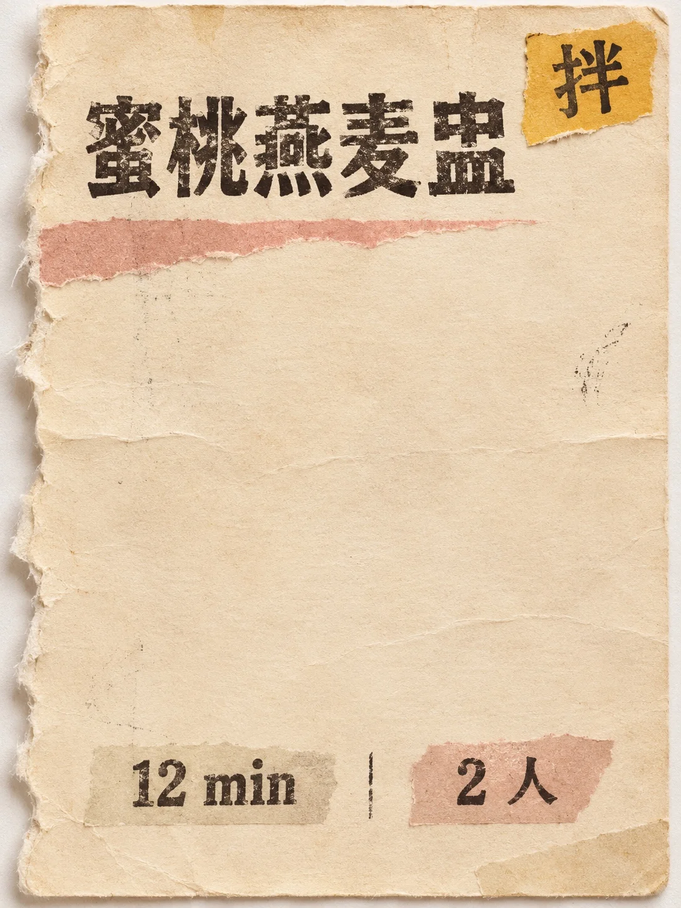

# Torn-Page Kitchen Recipe Card (Peach Oat Bowl)

**中文标题：** 厨房撕页食谱卡（蜜桃燕麦盅）  
**ID:** `gi25-x-1461` · **Mode:** `generate`  
**Categories:** `poster-typography`  
**Tags:** `x-twitter`, `community`, `gpt-image-2.5`, `x-direct`, `zh`



### Torn-Page Kitchen Recipe Card (Peach Oat Bowl)

```text
Create an image with the following visual system. Replace the subject as specified.

Visual system (light, color, composition, medium, mood):
一张竖幅约 2:3 到 3:4 的单张厨房撕页食谱卡特写，正面平视，像放在浅色桌面或白底上的实物纸片。卡片本身是做旧的哑光厚纸，一边或一角有手工撕边与纤维毛茬，表面可见细纸纹、轻微折痕、墨粉擦痕与小面积拼贴色条，能量来自撕纸杂志/做旧紧缩字体的实体纸感，但完成态是干净的单卡，不是滑板海报。版式信息稀疏可控：菜名用紧缩做旧无衬线或略粗的短标题居上或偏左；时间与份量用更小字分列；可有一处极短步骤词（如「炖」「烤」「拌」「蒸」）做成小色块标签；可有一条窄色带或撕纸色条装饰，不要人物肖像、滑板元素或复杂插画场景。油墨略有旧印刷不均与轻洇边。柔和均匀漫射光，纸面无强反光，阴影极浅。整张主纸色在奶油、桃色、鼠尾草绿、芥末黄四色中轮换其一；字墨以深褐或黑为主，可有一小块对比色标签。图上文字只出现 New subject 写明的四处，每处拼写准确、只出现一次；不要电话、网址、真实品牌/餐厅名、营养表小字堆、条码乱码。虚构菜名，像厨房抽屉里翻出来的一张手作撕页卡。

New subject:
奶油色撕页食谱卡。图上文字只有四处：菜名「蜜桃燕麦盅」；时间「12 min」；份量「2 人」；步骤词「拌」。菜名居上，时间与份量分列中下，步骤词在右上小色块标签。左侧有撕边。除此以外没有任何文字、品牌或标志。
```

- **Recommended model:** `gpt-image-2.5-sunburst`
- **Settings:** _(defaults)_
- **Source:** [community](https://x.com/static_stare/status/2119000434954158112) — @static_stare
- **License note:** Original public X post; quoted with attribution — remix with attribution
- **Notes:** Collected directly from X; original post https://x.com/static_stare/status/2119000434954158112; post text names GPT Image 2.5; discovered via X search, prompt re-verified against the original X post via api.fxtwitter.com; verified=True; visual-system + replaceable-subject template; prompt for image 1 of 4 (the author shares the other three on request); preview is image 1
- **Preview:** `previews/gi25-x-1461.webp`
