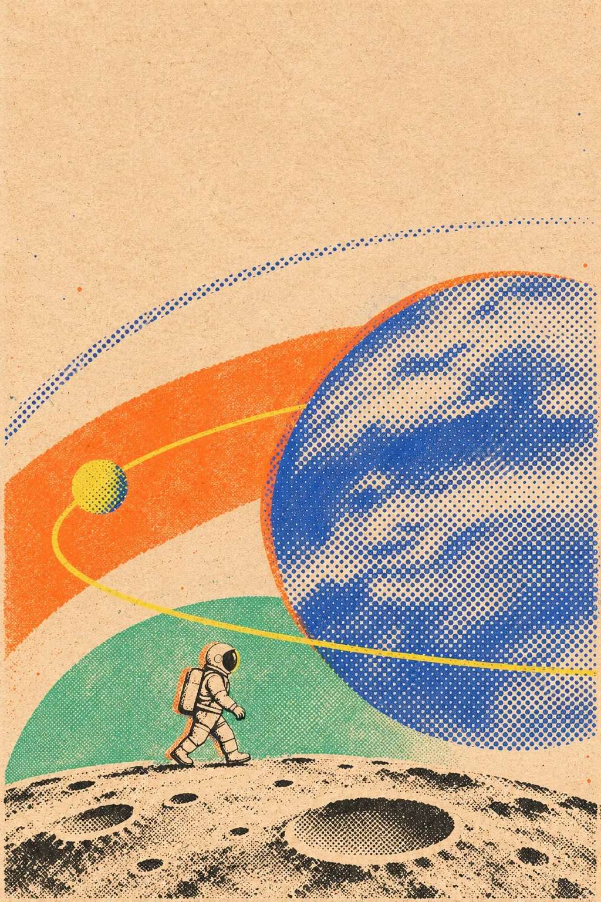

# Risograph Orbit Experiment Poster (Moonwalker)

**中文标题：** 孔版网点轨道实验海报（月面漫步者）  
**ID:** `gi25-x-1462` · **Mode:** `generate`  
**Categories:** `poster-typography`  
**Tags:** `x-twitter`, `community`, `gpt-image-2.5`, `x-direct`, `zh`



### Risograph Orbit Experiment Poster (Moonwalker)

```text
Create an image with the following visual system. Replace the subject as specified.

Visual system (light, color, composition, medium, mood):
一张竖幅约 2:3 到 3:4 的孔版/丝网实验海报：新闻纸米黄底上叠几何轨道、网点与有限霓虹色块，主体是可整体替换的场景剪影或半调插画人物/构筑物，不要复刻办公室制服女性身份。机位正面平视的平面版式，信息分层清晰：上沿可留大号无衬线标题位（若 New subject 未写字则留空不写字），中景放轨道弧线与行星色块，下半或一侧安放主体。纹理必须是孔版印刷感：细密新闻纸颗粒、半调网点、轻微套印错位与墨粉斑点，大面积平涂色块边缘略毛，不是矢量干净渐变。配色以米黄新闻纸为底，辅以黑墨线稿，点缀有限霓虹橙、钴蓝、柠檬黄与小块青绿；色块数量克制，不要彩虹乱炖。柔和均匀「印刷品扫描」光感，无立体摄影阴影。画面文字只出现 New subject 明确写出的短词，否则完全无字；禁止真实品牌、水印、网址。实验、复古未来、像刚从旧印刷机抽出来的轨道海报。

New subject:
月面漫步者：一个穿简洁太空服的小人侧影走在环形坑洼的月面剪影上，身后大弧轨道线与一颗半调网点大行星。画面中没有文字。
```

- **Recommended model:** `gpt-image-2.5-sunburst`
- **Settings:** _(defaults)_
- **Source:** [community](https://x.com/static_stare/status/2118973003367129344) — @static_stare
- **License note:** Original public X post; quoted with attribution — remix with attribution
- **Notes:** Collected directly from X; original post https://x.com/static_stare/status/2118973003367129344; post text names GPT Image 2.5; discovered via X search, prompt re-verified against the original X post via api.fxtwitter.com; verified=True; visual-system + replaceable-subject template; prompt for image 1 of 4 (the author shares the other three on request); preview is image 1
- **Preview:** `previews/gi25-x-1462.webp`
