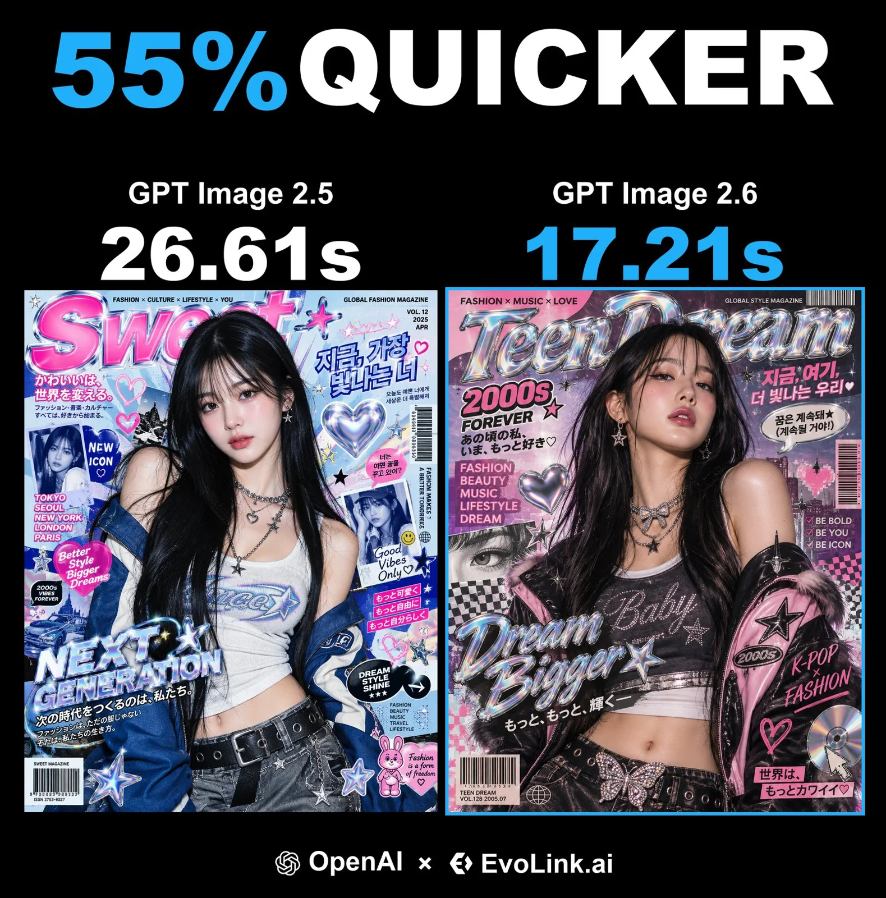

# Y2K Pop-Art Magazine K-Fashion Editorial Poster

**中文标题：** Y2K 波普杂志风韩系时尚海报  
**ID:** `gi25-x-1468` · **Mode:** `generate`  
**Categories:** `poster-typography`  
**Tags:** `x-twitter`, `community`, `gpt-image-2.5`, `x-direct`, `en`



### Y2K Pop-Art Magazine K-Fashion Editorial Poster

```text
Ultra-stylized high-fashion editorial poster featuring a confident young Asian female model, centered in frame, elegant posture, glossy radiant skin, soft dewy makeup, long silky black hair with wispy bangs, wearing trendy K-fashion streetwear with premium styling details. Clean studio lighting, high-contrast fashion flash photography, sharp focus, ultra-detailed textures, cinematic composition. Background packed with vibrant retro pop-art magazine aesthetics, layered graphic typography, dynamic UI-inspired design elements, holographic chrome effects, stickers including stars, hearts and sparkles, barcode strips, speech bubbles, futuristic collage layering. Japanese and Korean typographic accents woven in as visual design elements. Overall vibe blends nostalgic 2000s teen fashion magazine energy with modern luxury editorial campaign style. Bold color harmony, premium print quality, 8K resolution, polished commercial poster look, surreal yet stylish, trend-forward global fashion branding.
```

- **Recommended model:** `gpt-image-2.5-sunburst`
- **Settings:** _(defaults)_
- **Source:** [community](https://x.com/EvoLinkAi/status/2118704960602771521) — @EvoLinkAi
- **License note:** Original public X post; quoted with attribution — remix with attribution
- **Notes:** Collected directly from X; prompt posted as the author's own reply https://x.com/EvoLinkAi/status/2118704960602771521 to https://x.com/EvoLinkAi/status/2118704959839502380, which carries the images; GPT Image 2.5 is named in the parent post; discovered via X search, prompt re-verified against the original X post via api.fxtwitter.com; verified=True; speed comparison post (GPT Image 2.5 vs 2.6); prompt from the author's reply; GitHub link footer omitted; preview is the parent post image
- **Preview:** `previews/gi25-x-1468.webp`
