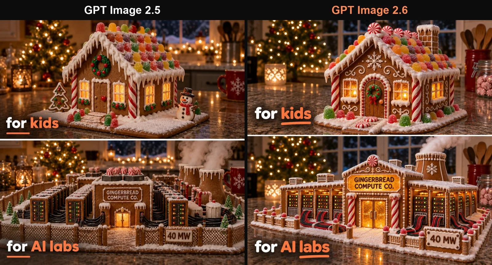

# Gingerbread House: For Kids vs For AI Labs Meme

**中文标题：** 姜饼屋梗图：给孩子 vs 给 AI 实验室  
**ID:** `gi25-x-1474` · **Mode:** `generate`  
**Categories:** `poster-typography`  
**Tags:** `x-twitter`, `community`, `gpt-image-2.5`, `x-direct`, `en`



### Gingerbread House: For Kids vs For AI Labs Meme

```text
Create a two-panel festive meme image, one panel on top of the other, separated by a thin white line.

Top panel: a cozy gingerbread house on a kitchen counter at night: candy-cane pillars, gumdrop roof, white icing snow on the eaves, warm light glowing in the sugar-glass windows, fairy lights and a small Christmas tree blurred behind. Caption in the lower left, bold white rounded sans-serif with the last word in orange #FF8A52 and a short orange underline: "for kids".

Bottom panel: the same counter and lighting, but the gingerbread is built as an AI data center: rows of gingerbread server racks with tiny blinking candy LEDs, licorice cables bundled along the floor, a frosting cooling tower puffing steam, a sugar-glass sign over the door reading "GINGERBREAD COMPUTE CO.", a little icing sign on the fence reading "40 MW". Same caption style: "for AI labs".

Constraints: photoreal food photography look, every piece of text spelled exactly as written and shown once, no other text, no watermark.
```

- **Recommended model:** `gpt-image-2.5-sunburst`
- **Settings:** _(defaults)_
- **Source:** [community](https://x.com/vestra_ai/status/2118273877491228927) — @vestra_ai
- **License note:** Original public X post; quoted with attribution — remix with attribution
- **Notes:** Collected directly from X; prompt posted as the author's own reply https://x.com/vestra_ai/status/2118273877491228927 to https://x.com/vestra_ai/status/2118273874349752644, which carries the images; GPT Image 2.5 is named in the parent post; discovered via Bin0754/gpt-image-gallery index, prompt re-verified against the original X post via api.fxtwitter.com; verified=True; comparison post (GPT Image 2.5 vs 2.6); prompt from the author's reply; preview is the parent post image
- **Preview:** `previews/gi25-x-1474.webp`
