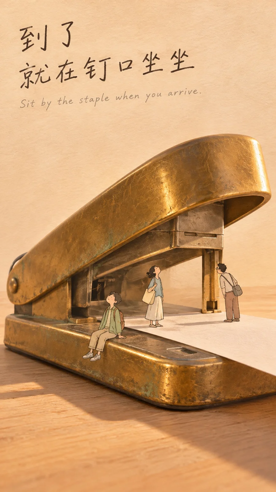

# Tiny People Living on a Giant Brass Stapler (Poster, 9:16)

**中文标题：** 巨物微人·黄铜订书机上的小人（海报·9:16）  
**ID:** `gi25-x-1484` · **Mode:** `generate`  
**Categories:** `poster-typography`, `general`  
**Tags:** `x-twitter`, `community`, `gpt-image-2.5`, `x-direct`, `zh`



### Tiny People Living on a Giant Brass Stapler (Poster, 9:16)

```text
Create an image with the following visual system. Replace the subject as specified.

Visual system (light, color, composition, medium, mood):
一张竖幅 9:16 的混合媒介概念海报。画面中心是一件可整体替换的巨型日常实物，材质必须是摄影级写实：正确的体积、边缘高光、接触阴影、微划痕和表面质感都要真实，它同时被当作建筑或地形来用。实物上、沿口或阴影里生活着若干细钢笔淡彩小人——线条干净、着色薄、带一点纸的颗粒，绝不能画成实拍人物或三维写实皮肤；小人相对物件必须很小，比例反差在时间线缩略图里一眼就能看出来。机位略低或平视，让物件轮廓在温暖米色、带轻微纸纹的天空或浅色桌面之前形成一个大而清晰的剪影；上方约三分之一留作负空间给标题，不要堆满配角，不要出现第二件巨型物件。光线是柔和的金色下午侧光，色温偏暖，地面或桌面有长短适中的柔和投影；写实物可以有真实反光、金属氧化或玻璃折射，小人始终保持插画纸感。左上方两行随手写下的深色中文手写标题，像签字笔写在纸上，字距略松，不是印刷海报字体；标题下面跟一行更小、更细的浅灰英文短句。不要品牌、商标、水印、二维码或网址。气氛安静、俏皮，日常里带一点出神，像一张能贴在墙上的概念插画海报。

New subject:
一只巨大的旧黄铜台式订书机斜放在浅色木桌或暖米色地面上，铜面有轻微氧化、细划痕和真实金属高光，按压臂抬起，钉口和砧板形成一座小小的厅堂或站台入口。几个手绘小人把钉口当站台：有人坐在砧板沿上歇脚，有人提着包站在纸槽口朝里看，有人抬头看头顶那块像雨棚一样的金属压臂。桌面上可以有一张普通白纸伸进钉口，像站台的地板，不要出现第二件巨型文具。画面左上方手写中文标题「到了 / 就在钉口坐坐」，下方小字英文 “Sit by the staple when you arrive.” 画面中不要品牌或水印。
```

- **Recommended model:** `gpt-image-2.5-sunburst`
- **Settings:** _(defaults)_
- **Source:** [community](https://x.com/static_stare/status/2120049258434887883) — @static_stare
- **License note:** Original public X post; quoted with attribution — remix with attribution
- **Notes:** Collected directly from X; original post https://x.com/static_stare/status/2120049258434887883; post text names GPT Image 2.5; discovered via X search, prompt re-verified against the original X post via api.fxtwitter.com; verified=True; visual-system + replaceable-subject template; prompt for image 1 of 4 (the author shares the other three on request); preview is image 1
- **Preview:** `previews/gi25-x-1484.webp`
