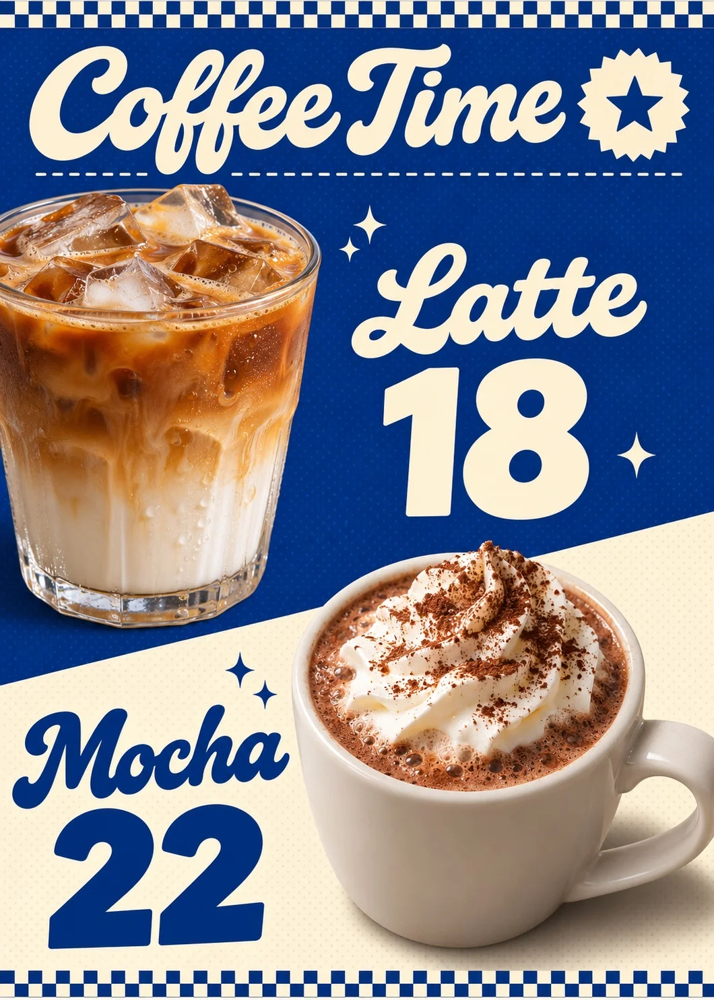

# Retro Café Menu Flyer with Blue-White Checks

**中文标题：** 蓝白格子复古菜单传单（咖啡店）  
**ID:** `gi25-x-1493` · **Mode:** `generate`  
**Categories:** `poster-typography`  
**Tags:** `x-twitter`, `community`, `gpt-image-2.5`, `x-direct`, `zh`



### Retro Café Menu Flyer with Blue-White Checks

```text
Create an image with the following visual system. Replace the subject as specified.

Visual system (light, color, composition, medium, mood):
一张竖幅约 5:7 的复古小店菜单传单，真实食物摄影抠图和平面色块拼贴，正面平视，像可以直接印刷的成品。上下边缘各一条蓝白双排棋盘格窄饰带。画面用一条从左上向右下斜降的分界线分成两块：上部深钴蓝底约占六成，下部暖奶油白底约占四成，底色是平整的哑光色块，铺一层很淡的半调圆点。左上角是圆润粗笔画的复古连写体大标题，奶油白色；右上角一枚奶油色放射齿边小徽章，里面只画一颗深蓝小星星，不写字；标题下一条细虚线。第一款食物大幅近景抠图从左侧裁切入画，落在蓝底上，它右边是同款连写体的品名，品名下是超大的粗无衬线价格数字，都是奶油白；第二款食物从右下前景放大入画、跨过斜线，它左边是深钴蓝的连写体品名和超大深钴蓝价格数字。食物用略俯视的三分之四角度，左上方中性偏暖的柔光，右下落柔软灰褐阴影，表面纹理、油润反光和真实色泽清楚，抠图边缘干净没有白边。旁边点两三颗四角尖闪星。颜色只用钴蓝和奶油白，其他颜色只出现在食物里。图上只出现 New subject 里写明的文字，每个词拼写准确、只出现一次，不要说明小字、电话、网址、店招 logo、真实品牌或其他任何字。亲切、轻快，像街角小店门口贴的那张菜单。

New subject:
一家咖啡小店。第一款：一杯装在透明玻璃杯里的冰拿铁，奶和咖啡分层、浮着冰块；第二款：一杯顶上挤了奶油、撒了可可粉的热摩卡，装在白色厚瓷杯里。图上文字只有五个短词：大标题「Coffee Time」；第一款品名「Latte」，价格「18」；第二款品名「Mocha」，价格「22」。除此以外没有任何文字、品牌或标志。
```

- **Recommended model:** `gpt-image-2.5-sunburst`
- **Settings:** _(defaults)_
- **Source:** [community](https://x.com/static_stare/status/2118275247702954418) — @static_stare
- **License note:** Original public X post; quoted with attribution — remix with attribution
- **Notes:** Collected directly from X; original post https://x.com/static_stare/status/2118275247702954418; post text names GPT Image 2.5; discovered via Bin0754/gpt-image-gallery index, prompt re-verified against the original X post via api.fxtwitter.com; verified=True; visual-system + replaceable-subject template; prompt for image 1 of 4 (the author shares the other three on request); preview is image 1
- **Preview:** `previews/gi25-x-1493.webp`
