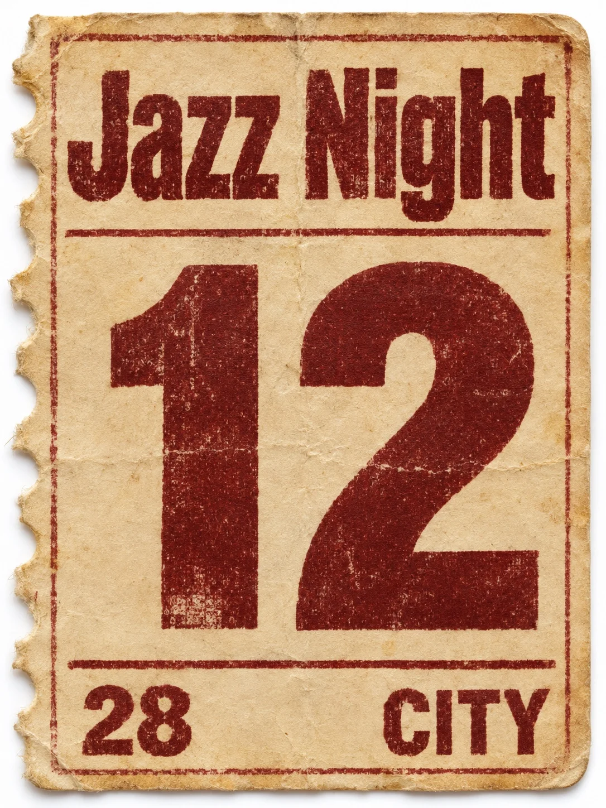

# Vintage Admission Ticket Stub (Jazz Night)

**中文标题：** 复古入场票根（Jazz Night）  
**ID:** `gi25-x-1495` · **Mode:** `generate`  
**Categories:** `poster-typography`  
**Tags:** `x-twitter`, `community`, `gpt-image-2.5`, `x-direct`, `zh`



### Vintage Admission Ticket Stub (Jazz Night)

```text
Create an image with the following visual system. Replace the subject as specified.

Visual system (light, color, composition, medium, mood):
一张竖幅约 2:3 到 3:4 的单张复古入场票根特写，正面平视，像扫在白底上的实物摄影。票纸是做旧的哑光卡纸，有轻微折痕、发黄边、软磨损；一侧或两端有齿孔撕边，齿孔不规则、略毛。版式紧缩、信息密度高：粗无衬线大号座位号最抢眼并成为视觉重心，活动名用紧缩无衬线或略带工业感的粗体压在上方，票价与场地名用较小无衬线分列下沿；可有细分隔线、窄色条边，不要花哨插画或肖像。油墨略有旧印刷不均与轻微洇边，不是矢量干净字。柔和均匀漫射光，纸面无强烈反光，阴影极浅。整张只用一种主纸色（奶油/桃色/青绿/芥末四选一），字墨以黑或深红褐为主。图上文字只出现 New subject 写明的四处，每处拼写准确、只出现一次；不要电话、网址、真实乐队/品牌/场馆名、条码旁一串乱码、法律小字堆。干净、怀旧，像抽屉里翻出来的一张旧票根。

New subject:
奶油色旧票根。图上文字只有四处：活动名「Jazz Night」；座号「12」；票价「28」；城市名「CITY」。大号座号居中偏右，活动名在上方，票价与 CITY 分列下沿。齿孔撕边在左侧。除此以外没有任何文字、品牌或标志。
```

- **Recommended model:** `gpt-image-2.5-sunburst`
- **Settings:** _(defaults)_
- **Source:** [community](https://x.com/static_stare/status/2118641857320165852) — @static_stare
- **License note:** Original public X post; quoted with attribution — remix with attribution
- **Notes:** Collected directly from X; original post https://x.com/static_stare/status/2118641857320165852; post text names GPT Image 2.5; discovered via Bin0754/gpt-image-gallery index, prompt re-verified against the original X post via api.fxtwitter.com; verified=True; visual-system + replaceable-subject template; prompt for image 1 of 4 (the author shares the other three on request); preview is image 1
- **Preview:** `previews/gi25-x-1495.webp`
