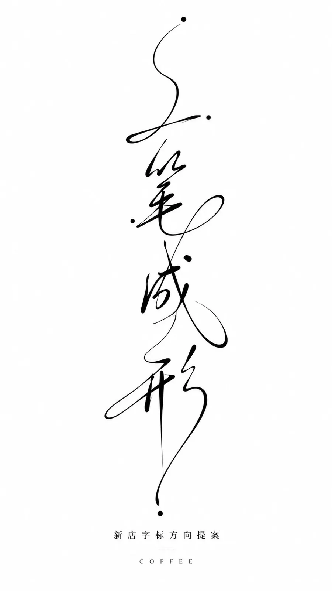

# One-Stroke Calligraphic Wordmark Poster (9:16)

**中文标题：** 一笔成形·连写字标提案海报（9:16）  
**ID:** `gi25-x-1496` · **Mode:** `generate`  
**Categories:** `poster-typography`  
**Tags:** `x-twitter`, `community`, `gpt-image-2.5`, `x-direct`, `zh`



### One-Stroke Calligraphic Wordmark Poster (9:16)

```text
以一列几乎垂直居中的黑色连续书写线柱作为第一眼核心：极细长的曲线、夸张回环、孤立圆点和突然伸出的长尾，在巨大洁白留白中形成极端的尺度反差。采用非对称中轴构成与格式塔连续性原则，由上至下分成数个松散字形单元，上方轻、下方稳，重心沿中轴轻微摆动，任何画幅都保持这种呼吸感和平衡。文字层与图像层合为同一套抽象字形系统，笔画彼此穿插，线条同时承担书写、分隔和构图骨架功能，阅读动线从顶部弧线和端点开始，沿曲线下滑，经过中部密集回环，最后停在下部较大的收束形。文字无论多少都守这个层级：主字形承担最大尺度和最长延展，次级字形收紧在中部，圆点与短划作为停顿标记，字重以细线为主，局部回环叠压出粗细节奏，端点用圆点、尖收和悬停制造速度差。留白遵循格式塔邻近与负形原则，纯白区域托住黑线，单元之间保留可呼吸的间隔，孤立点和长尾由周围空白烘托，空白本身成为构图力量。画什么和写什么由追加的主题提供，构图只保留中部狭窄的一列抽象字形物象，画面里只有这一处物象，其余是洁白平整底色，不生出任何景物；有分量的竖向骨架保持端正，斜势和延展只交给轻盈的回环、尾线与短划。采用几种手法的复合：先以签字笔式的快速连写确定主路径，再用利落的矢量勾线统一边缘，用圆点和短划补出停顿，用局部重叠模拟一次书写中的回锋与压笔，整体像一条被精确描摹的黑色签字笔轨迹。色彩遵循高明度、极高对比、无彩色配色原理，全画面只用纯黑线条和洁白底色，不引入任何彩色；黑色集中在回环交叠、长尾和圆点处，形成厚重锚点，白色保持轻薄通透，心理感受冷静、机敏、克制而有即兴活力，无论什么主题都保持这种明暗、厚薄、冷暖倾向与浓淡性格。整体气质是把签名式书写动作压缩成极简字形构成；末尾追加的主题、准确文字、用途与画幅优先，连续线柱的中轴平衡、巨大留白、细线回环、圆点定拍、黑白单色和无景物背景保持不变。

——————
主题：品牌设计咖啡馆字标提案海报
标题：「一笔成形」
副标题：「新店字标方向提案」
竖版 9:16
```

- **Recommended model:** `gpt-image-2.5-sunburst`
- **Settings:** _(defaults)_
- **Source:** [community](https://x.com/xiaoxiaodong/status/2117855207958958379) — @xiaoxiaodong
- **License note:** Original public X post; quoted with attribution — remix with attribution
- **Notes:** Collected directly from X; original post https://x.com/xiaoxiaodong/status/2117855207958958379; post text names GPT Image 2.5; discovered via Bin0754/gpt-image-gallery index, prompt re-verified against the original X post via api.fxtwitter.com; verified=True; style-system prompt drafted by the author with Opus 5.5 for GPT-image2.5; theme/title block at the end is replaceable
- **Preview:** `previews/gi25-x-1496.webp`
