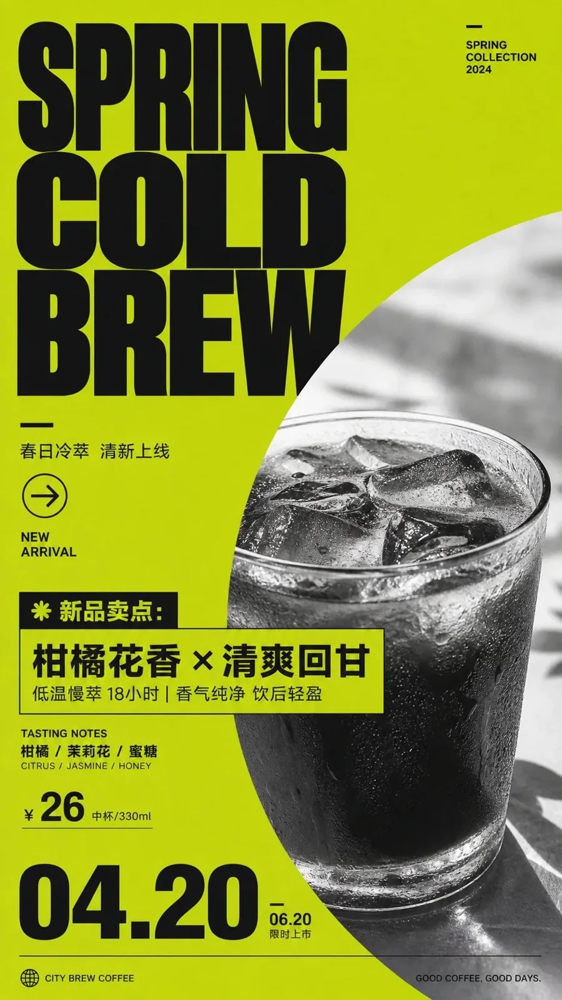

# Bold Color-Field Info Poster (Cold Brew Coffee, 9:16)

**中文标题：** 高饱和色场信息海报（冷萃咖啡·9:16）  
**ID:** `gi25-x-1498` · **Mode:** `generate`  
**Categories:** `poster-typography`  
**Tags:** `x-twitter`, `community`, `gpt-image-2.5`, `x-direct`, `zh`



### Bold Color-Field Info Poster (Cold Brew Coffee, 9:16)

```text
围绕任意主题对象生成一张强信息感的图像海报：画面先读到大面积纯净高饱和的主题情绪色场，色彩来自主题自身的材质、文化语义与情绪温度，作为主背景占据绝大部分面积；深色信息文字承担结构重量，以极粗、紧凑、几何感强的无衬线标题压在一侧上方，字距收紧、行距紧密，形成像标识一样的黑色视觉锚点，并配少量细字说明、短横线、圆形方向符号或小型索引元素，制造冷静、直接、带宣言感的阅读节奏。主题对象作为主要影像载体，不以完整陈列出现，而被一个巨大的弧形或近圆形色块边界从画面边缘切入、遮挡和释放，形成色场与影像之间的强烈图底张力；影像内部使用高反差单色处理，保留真实纹理、明暗层次和颗粒感，与平整背景形成材料差异。中下部可放一段紧凑说明文字，让它部分压过色场与影像交界，增强拼贴压力和信息密度；底部使用超大数字或日期式编号与一条细长水平线建立秩序感。整体颜色保持明亮、干净、锋利、有能量：大面积主题派生亮色负责情绪冲击，黑色或极深色负责文字和结构，小面积浅灰单色层次承载影像细节，饱和度集中而不浑浊，边界清晰，留白大胆，完成一种鲜明、现代、纪念性、编辑设计感强的视觉表达。

——————
主题：城市咖啡馆春季新品海报，突出一杯具有鲜明风味的冷萃咖啡
补充：加入一个清晰新品卖点，保留少量价格或口味信息
画幅：竖版 9:16
```

- **Recommended model:** `gpt-image-2.5-sunburst`
- **Settings:** _(defaults)_
- **Source:** [community](https://x.com/xiaoxiaodong/status/2119714857121611854) — @xiaoxiaodong
- **License note:** Original public X post; quoted with attribution — remix with attribution
- **Notes:** Collected directly from X; original post https://x.com/xiaoxiaodong/status/2119714857121611854; post text names GPT Image 2.5; discovered via Bin0754/gpt-image-gallery index, prompt re-verified against the original X post via api.fxtwitter.com; verified=True; prompt for image 4 of the post; preview is image 4; theme block at the end is replaceable
- **Preview:** `previews/gi25-x-1498.webp`
