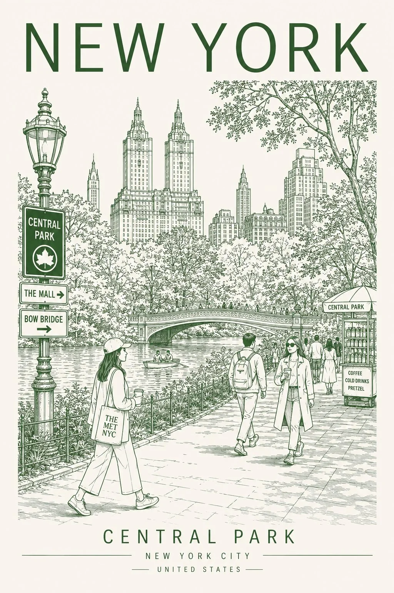

# Minimalist Line-Art City Travel Poster Template

**中文标题：** 极简线描城市旅行海报模板  
**ID:** `gi25-x-1504` · **Mode:** `generate`  
**Categories:** `poster-typography`, `general`  
**Tags:** `x-twitter`, `community`, `gpt-image-2.5`, `x-direct`, `en`



### Minimalist Line-Art City Travel Poster Template

```text
Create a minimalist travel-poster style line art illustration of [CITY NAME], in a vertical poster format. Use clean architectural ink drawing lines with a monochrome palette (black, sepia, or muted red tones) on an off-white background. Feature an iconic landmark of the city centered in the distance, with detailed urban street perspective leading toward it. Include pedestrians crossing the street, cyclists, cars, storefronts, traffic lights, street signs, subway/metro signs, and local cultural details unique to the city. Add realistic building facades with fine line detail and light shading.
At the top, place the city name in very large bold modern sans-serif typography. At the bottom, add the country name and native-language text in a minimalist layout. Keep the composition symmetrical and balanced like a premium vintage travel poster mixed with modern Japanese editorial design.
Style keywords: ultra detailed line art, architectural sketch, urban perspective drawing, clean vector ink illustration, travel poster aesthetic, minimal monochrome, cinematic street scene, soft beige paper texture, highly detailed cityscape, contemporary poster design, elegant typography, Muji-style minimalism.
```

- **Recommended model:** `gpt-image-2.5-sunburst`
- **Settings:** _(defaults)_
- **Source:** [community](https://x.com/iamsofiaijaz/status/2120369497513382085) — @iamsofiaijaz
- **License note:** Original public X post; quoted with attribution — remix with attribution
- **Notes:** Collected directly from X; prompt posted as the author's own reply https://x.com/iamsofiaijaz/status/2120369497513382085 to https://x.com/iamsofiaijaz/status/2120369045572894720, which carries the images; GPT Image 2.5 is named in the parent post; discovered via X search, prompt re-verified against the original X post via api.fxtwitter.com; verified=True; replace [CITY NAME]; preview is image 1 of the parent post
- **Preview:** `previews/gi25-x-1504.webp`
