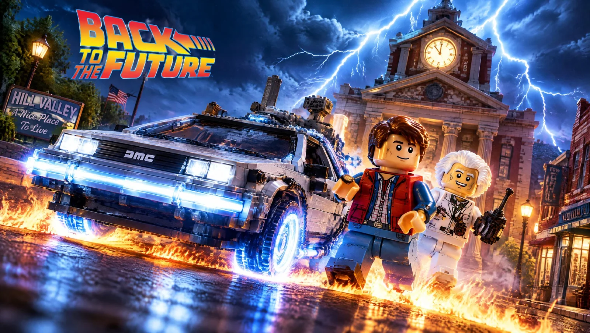

# LEGO-Style Movie Collector Set Poster Template

**中文标题：** 乐高风电影收藏套装海报模板  
**ID:** `gi25-x-1506` · **Mode:** `generate`  
**Categories:** `poster-typography`, `general`  
**Tags:** `x-twitter`, `community`, `gpt-image-2.5`, `x-direct`, `en`



### LEGO-Style Movie Collector Set Poster Template

```text
Create an epic LEGO-style cinematic collector poster inspired by [MOVIE TITLE]. Show the most iconic [vehicle / location / creature / object] in detailed brick-built form, with the main characters as LEGO-style mini figures. Add dramatic lighting, dynamic action, recognizable visual elements from the movie, and a strong atmosphere matching the film’s genre. Make it look like a premium movie poster, colorful, polished, highly detailed, and worthy of a limited-edition LEGO collector set.
```

- **Recommended model:** `gpt-image-2.5-sunburst`
- **Settings:** _(defaults)_
- **Source:** [community](https://x.com/CharaspowerAI/status/2120184821171319248) — @CharaspowerAI
- **License note:** Original public X post; quoted with attribution — remix with attribution
- **Notes:** Collected directly from X; original post https://x.com/CharaspowerAI/status/2120184821171319248; post text names GPT Image 2.5; discovered via X search, prompt re-verified against the original X post via api.fxtwitter.com; verified=True; replace [MOVIE TITLE] and the [vehicle / location / creature / object] slot
- **Preview:** `previews/gi25-x-1506.webp`
