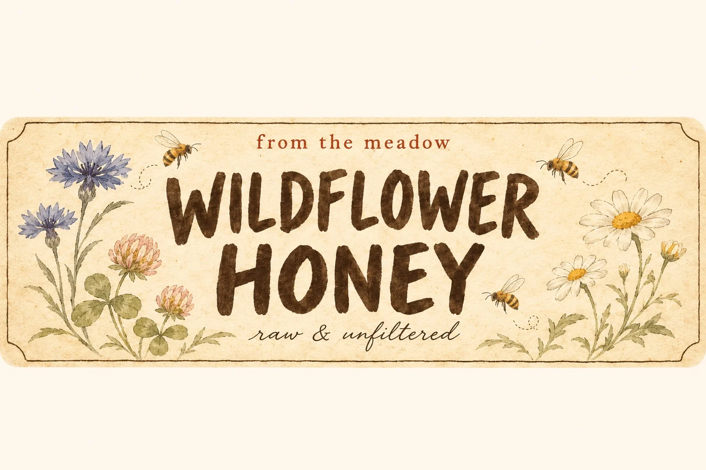

# Vintage Food Jar Label: Wildflower Honey (3:2)

**中文标题：** 复古食品罐标签：野花蜂蜜（3:2）  
**ID:** `gi25-x-1510` · **Mode:** `generate`  
**Categories:** `poster-typography`  
**Tags:** `x-twitter`, `community`, `gpt-image-2.5`, `x-direct`, `zh`



### Vintage Food Jar Label: Wildflower Honey (3:2)

```text
Create an image with the following visual system. Replace the subject as specified.

Visual system (light, color, composition, medium, mood):
【画面风格】一张横幅约 3:2 的复古食品罐标签平面设计稿：画面中央是一张横向长条标签，几乎占满画面宽度、约占一半高度，四周露出一圈更浅的暖白背景。标签纸是温暖的象牙米色，带细微的纸纤维颗粒和少量做旧小斑点，正面平拍、均匀平光，没有阴影、透视、罐子或桌面。标签中央是主角：大号手写感粗体无衬线的产品名，分两行排，下面跟一行很小的手写花体短句；产品名两侧或周围环绕一组水彩加细墨线手绘图案，颜色克制、半透明、留着笔触边缘。标签正上方居中有一行很小的砖红色衬线小字作品类标语。标签左右两端各留一块素净区域，只放一个细线小框或一个简单的手绘小图标，不放条码、营养成分表、配料表、数字、重量或回收标志。配色：象牙米色底，黑褐色墨字，图案只用一到两种低饱和颜色，加那一行砖红小字点缀。整张标签上的文字只有主体里指定的三处，逐字照写、拼写准确，不添加任何其他文字、品牌或 Logo。克制、干净，带一点手作小铺的复古感，可以直接拿去做罐子贴纸。

New subject:
【主体】野花蜂蜜标签。产品名两行："WILDFLOWER" / "HONEY"；下面花体小字："raw & unfiltered"；顶部砖红小字："from the meadow"。图案：几株手绘矢车菊、三叶草和小野菊，两三只小蜜蜂绕着飞，颜色用蜂蜜金和灰蓝。标签上只有这三处文字。
```

- **Recommended model:** `gpt-image-2.5-sunburst`
- **Settings:** _(defaults)_
- **Source:** [community](https://x.com/static_stare/status/2120089181577982443) — @static_stare
- **License note:** Original public X post; quoted with attribution — remix with attribution
- **Notes:** Collected directly from X; original post https://x.com/static_stare/status/2120089181577982443; post text names GPT Image 2.5; discovered via X search, prompt re-verified against the original X post via api.fxtwitter.com; verified=True; visual-system + replaceable-subject template; prompt for image 1 of 4 (the author shares the other three on request); preview is image 1
- **Preview:** `previews/gi25-x-1510.webp`
