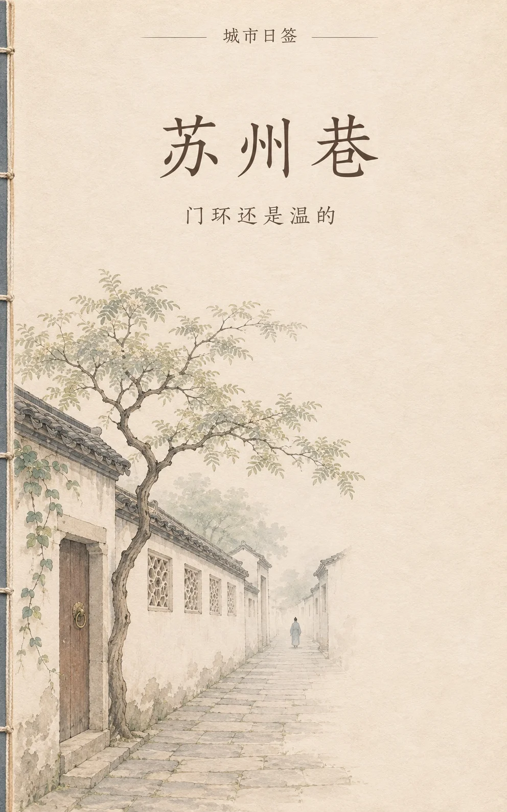

# Classical City Day Card: Suzhou Lane in Fine Ink Line (5:8)

**中文标题：** 古意城市日签：线描留白苏州巷（5:8）  
**ID:** `gi25-x-1540` · **Mode:** `generate`  
**Categories:** `poster-typography`, `general`  
**Tags:** `x-twitter`, `community`, `gpt-image-2.5`, `x-direct`, `zh`



### Classical City Day Card: Suzhou Lane in Fine Ink Line (5:8)

```text
Create an image with the following visual system. Replace the subject as specified.

Visual system (light, color, composition, medium, mood):
【画面风格】一张竖幅约 5:8 的古意城市日签，像线装书里夹着的一页插画：底是温暖的米白或浅宣纸色，能看见很淡的纸纹。画面下半或一侧是细墨线加薄淡彩画出的城市小景，上半和一侧留出大片空白。线要细、要稳，颜色是矿物感的浅彩（石绿、花青、赭石、胭脂只点很少），不要厚涂、不要照片、不要现代扁平插画。光线是均匀的纸面环境光，没有强烈的投影，空气有一点薄雾。文字只允许三处，必须是端正的中文，逐字照写、不写错、间距均匀：1）顶部一行很小的类别「城市日签」，可配一条细线；2）画面上方或空白处一个较大的地名标题，两到四个字，细的宋体或细楷；3）标题附近或另一侧空白处一句短签，四到八个字，字号明显小于标题。不要写「早安」，不要写长解签、不要写日期、不要英文段落、不要印章里的乱码、不要地图针和logo。整张最多这三处文字。气质安静、留白多，像傍晚也可以看的一页。

New subject:
【主体】类别：「城市日签」；标题：「苏州巷」；短签：「门环还是温的」。画面左下是一条青石板小巷，白墙、窄门、一排漏窗，巷口有一棵很细的老槐，墙上一点爬藤。人只在远处留一个很小的背影。全图只有这三处文字。
```

- **Recommended model:** `gpt-image-2.5-sunburst`
- **Settings:** _(defaults)_
- **Source:** [community](https://x.com/static_stare/status/2121538613465010588) — @static_stare
- **License note:** Original public X post; quoted with attribution — remix with attribution
- **Notes:** Collected directly from X; original post https://x.com/static_stare/status/2121538613465010588; post text names GPT Image 2.5; discovered via X search, prompt re-verified against the original X post via api.fxtwitter.com; verified=True; visual-system + replaceable-subject template; prompt for image 1 of 4 (the author offers the other three on request); post names GPT Image 2.5 without a Flare/Sunburst variant; preview is image 1
- **Preview:** `previews/gi25-x-1540.webp`
