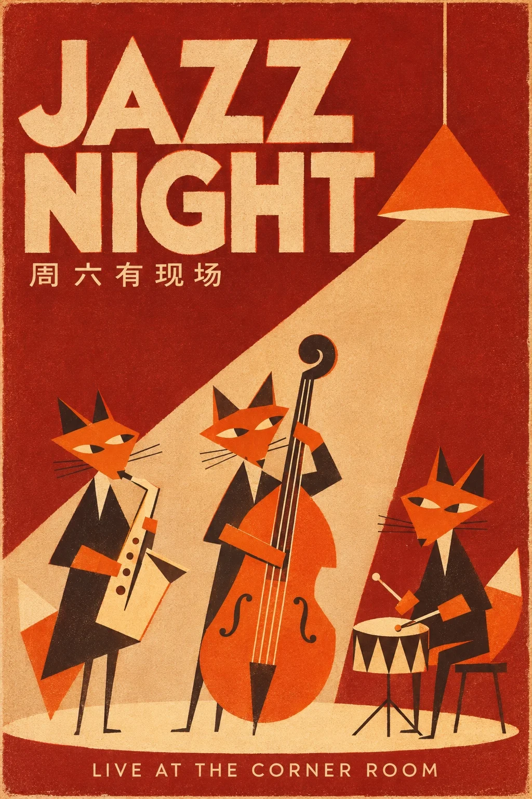

# Mid-Century Geometric Gig Poster: JAZZ NIGHT Foxes (2:3)

**中文标题：** 中世纪几何演出海报：爵士狐狸 JAZZ NIGHT（2:3）  
**ID:** `gi25-x-1542` · **Mode:** `generate`  
**Categories:** `poster-typography`  
**Tags:** `x-twitter`, `community`, `gpt-image-2.5`, `x-direct`, `zh`



### Mid-Century Geometric Gig Poster: JAZZ NIGHT Foxes (2:3)

```text
Create an image with the following visual system. Replace the subject as specified.

Visual system (light, color, composition, medium, mood):
【画面风格】一张竖幅约 2:3 的复古中世纪风演出海报。纯几何造型：角色的身体用三角形、长方形、细线腿和细线胡须拼成，眼睛是细长的半月形；背景是暖橙、砖红和米黄的大色块，一束斜向的米黄色聚光从上方的三角形灯罩打下来，在地面落成一块亮地。所有形状边缘带一点套色错位和纸张颗粒，像上世纪五十年代唱片封套的丝网印。色彩限制在暖橙、砖红、米黄、焦黑四色加一点奶油白，不要蓝绿紫。文字只允许三处，必须逐字照写、拼写正确、不要多出别的字：1）画面上方或一侧的大号英文标题，粗的几何无衬线字体；2）标题下一行很小的中文短句；3）画面底部一条细小的英文信息行。不要真实品牌、不要网址、不要二维码、不要日期和票价、不要乱码署名。构图上半留给标题和灯，下半是舞台和主体。像一张能直接换主题的演出海报，傍晚贴出去刚好。

New subject:
【主体】爵士小夜场。三只几何狐狸：一只吹萨克斯，一只拉立式贝斯，一只坐在小鼓后面，狐狸身体是橙黑三角形。背景是砖红墙和一盏三角灯罩。标题：「JAZZ NIGHT」；中文：「周六有现场」；底部小字：「LIVE AT THE CORNER ROOM」。全图只有这三处文字。
```

- **Recommended model:** `gpt-image-2.5-sunburst`
- **Settings:** _(defaults)_
- **Source:** [community](https://x.com/static_stare/status/2121939453984018568) — @static_stare
- **License note:** Original public X post; quoted with attribution — remix with attribution
- **Notes:** Collected directly from X; original post https://x.com/static_stare/status/2121939453984018568; post text names GPT Image 2.5; discovered via X search, prompt re-verified against the original X post via api.fxtwitter.com; verified=True; visual-system + replaceable-subject template; prompt for image 1 of 4 (the author offers the other three on request); post names GPT Image 2.5 without a Flare/Sunburst variant; preview is image 1
- **Preview:** `previews/gi25-x-1542.webp`
