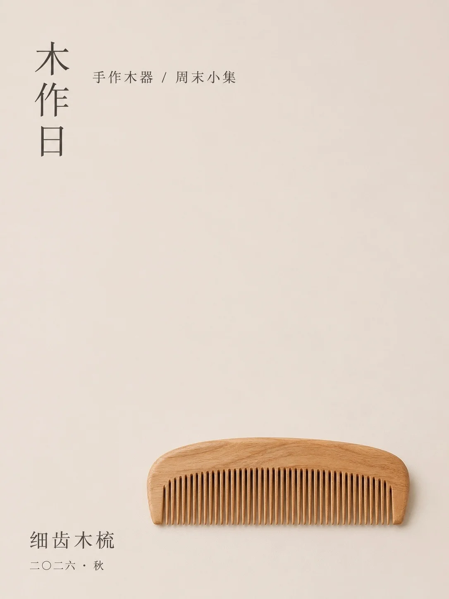

# Minimal Object Poster with Chinese Type: Fine-Tooth Wooden Comb (3:4)

**中文标题：** 留白器物极简海报：细齿木梳（3:4）  
**ID:** `gi25-x-1545` · **Mode:** `generate`  
**Categories:** `poster-typography`  
**Tags:** `x-twitter`, `community`, `gpt-image-2.5`, `x-direct`, `zh`



### Minimal Object Poster with Chinese Type: Fine-Tooth Wooden Comb (3:4)

```text
Create an image with the following visual system. Replace the subject as specified.

Visual system (light, color, composition, medium, mood):
【画面风格】一张竖幅约 3:4 的极简器物海报，像品牌手册里的单页：大部分是干净、均匀的浅色背景，几乎占掉画面的三分之二，只有一件实物放在画面偏下、偏右的位置，体积不大，周围留出大量空白。光线是柔和的棚拍平光，微微从左上方来，器物底下只有一小片很淡的接触阴影，没有戏剧性的硬影。背景色和器物是同一色系的浅色，饱和度低。文字很少，而且位置固定：左上或左侧有一行竖排或横排的中文标题（四个字），标题旁边或下方可以有一行更小的说明；器物附近或左下有物件名称；再允许一处很小的日期或短句。全部文字都要逐字照写、端正、间距均匀，用细的衬线或细黑体，颜色是深灰或近黑，不要花体、不要英文段落、不要Logo、不要假印章里的乱码。整张海报上的文字最多四处，除此之外不添加任何字母、数字或签名。质感是安静的产品摄影加极简中文排版，不要插画风，不要复杂场景。留白、克制，可以直接拿去做展览页或桌面壁纸。

New subject:
【主体】浅米色背景。左上竖排标题：「木作日」；标题右侧小字：「手作木器 / 周末小集」。左下物件名：「细齿木梳」；日期：「二〇二六 · 秋」。画面偏右下方平放一把浅茶色细齿木梳，梳齿清楚，木头有轻微纹理。全图只有这四处文字。
```

- **Recommended model:** `gpt-image-2.5-sunburst`
- **Settings:** _(defaults)_
- **Source:** [community](https://x.com/static_stare/status/2121176440859414880) — @static_stare
- **License note:** Original public X post; quoted with attribution — remix with attribution
- **Notes:** Collected directly from X; original post https://x.com/static_stare/status/2121176440859414880; post text names GPT Image 2.5; discovered via X search, prompt re-verified against the original X post via api.fxtwitter.com; verified=True; visual-system + replaceable-subject template; prompt for image 1 of 4 (the author offers the other three on request); post names GPT Image 2.5 without a Flare/Sunburst variant; preview is image 1
- **Preview:** `previews/gi25-x-1545.webp`
