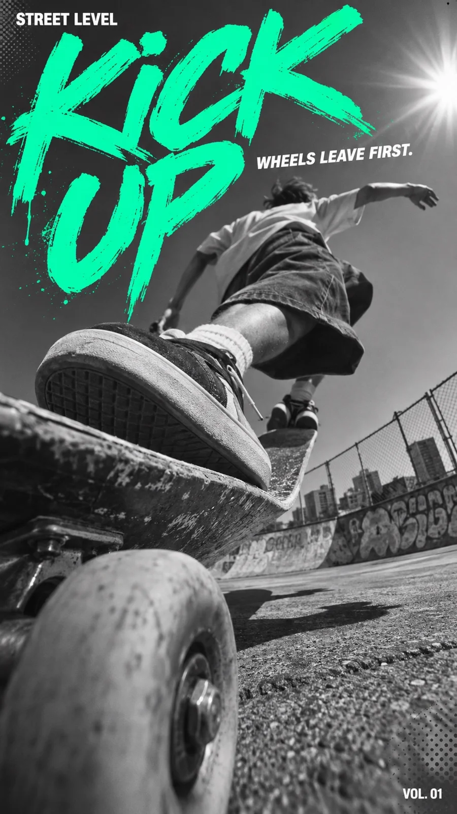

# Ground-Level Street Sports Magazine Page: KICK UP Skateboard (9:16)

**中文标题：** 贴地仰拍街头运动刊：KICK UP 滑板（9:16）  
**ID:** `gi25-x-1548` · **Mode:** `generate`  
**Categories:** `poster-typography`  
**Tags:** `x-twitter`, `community`, `gpt-image-2.5`, `x-direct`, `zh`



### Ground-Level Street Sports Magazine Page: KICK UP Skateboard (9:16)

```text
Create an image with the following visual system. Replace the subject as specified.

Visual system (light, color, composition, medium, mood):
【画面风格】一张竖幅约 9:16 的街头运动杂志内页：镜头几乎贴在地面，广角、仰拍，前景被一只手、一只脚、一只轮胎或一件器材强烈放大，人物和场地向远处急剧缩小，有夸张的透视和轻微的边缘畸变。这是硬日光下的实景摄影，影子短而清楚，地面有粗糙质感（柏油、水泥、石或泥土），背景可以有围网、墙或少量围观的人，但不要把任何人的脸当主角特写到能认出来的程度，也不要出现真实品牌、队徽、店招和可读商标。排版是街头刊物风，但文字严格只有四处，必须逐字照写、拼写正确：1）画面顶部或一角一个很小的刊名，粗无衬线，两个英文词；2）主标题，超大的手写或涂鸦笔触英文，可以斜切、可以跨两行，颜色是画面里唯一的高饱和强调色；3）一句很短的英文口号，三到五个词，放在标题附近；4）底部一条很小的期次，如 VOL. 01。不要再加说明框、引文框、特写小窗里的标题、也不要大段英文。角落可以有很淡的半调波点或一点油墨飞溅，不要遮住主体。质感是高对比的街头摄影加粗字体，不要插画、不要 3D、不要电影宽银幕黑边。有冲击力，但字很少。

New subject:
【主体】刊名："STREET LEVEL"；主标题："KICK UP"；口号："WHEELS LEAVE FIRST."；底部："VOL. 01"。镜头贴在滑板场地面，前景是一块滑板的尾部和一只刚要离开板面的运动鞋，板轮几乎顶到镜头，滑板的人在上空，城市围网在远处。强调色用青绿。全图只有这四处文字。
```

- **Recommended model:** `gpt-image-2.5-sunburst`
- **Settings:** _(defaults)_
- **Source:** [community](https://x.com/static_stare/status/2121511061585301845) — @static_stare
- **License note:** Original public X post; quoted with attribution — remix with attribution
- **Notes:** Collected directly from X; original post https://x.com/static_stare/status/2121511061585301845; post text names GPT Image 2.5; discovered via X search, prompt re-verified against the original X post via api.fxtwitter.com; verified=True; visual-system + replaceable-subject template; prompt for image 1 of 4 (the author offers the other three on request); post names GPT Image 2.5 without a Flare/Sunburst variant; preview is image 1
- **Preview:** `previews/gi25-x-1548.webp`
