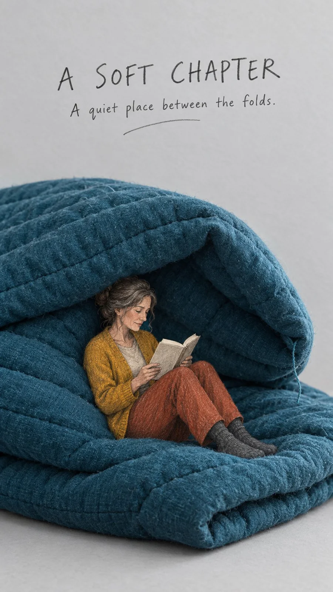

# Mixed-Media Poster: Tiny Hand-Drawn Reader in a Real Quilt Fold (9:16)

**中文标题：** 混合媒介海报：真实被子褶里的手绘小读者（9:16）  
**ID:** `gi25-x-1558` · **Mode:** `generate`  
**Categories:** `poster-typography`, `general`  
**Tags:** `x-twitter`, `community`, `gpt-image-2.5`, `x-direct`, `en`



### Mixed-Media Poster: Tiny Hand-Drawn Reader in a Real Quilt Fold (9:16)

```text
Create a vertical 9:16 mixed-media editorial poster. A folded petrol-blue quilt is the dominant photographic object, its open fold forming a small sheltered reading nook on a pale cool-gray paper background. Preserve the quilt's recognizable shape, visible cotton fibers, stitched channels, soft thickness and believable weight. A single tiny illustrated adult in their forties sits inside the fold, knees comfortably bent, holding an open unlettered book. Their mustard cardigan, rust trousers and charcoal socks have delicate colored-pencil shading. Their face has mature proportions and a quietly absorbed expression.

The quilt remains photorealistic while the person remains visibly hand-drawn, with expressive graphite outlines, subtle warm skin shading and individual hair strokes. Do not turn the person into a rendered toy. The adult leans gently against the fabric wall; their feet rest on the lower quilt fold. Add coherent contact shadows and natural overlap where the drawing touches the real fibers. A loose thread at the fold gives scale without creating clutter.

Light the scene from the upper right with soft window light, cool shadows and restrained warm highlights. Retain clear separation between petrol blue, mustard, rust and the gray ground. Place the quilt in the lower two-thirds, with enough space above for the headline. Set "A SOFT CHAPTER" in slightly irregular handwritten lettering, then "A quiet place between the folds." in smaller handwriting. Include one subtle curved underline. These are the only words.

The image should read first as a real quilt, then reveal a small, comforting illustrated story. Keep the composition rich in tactile detail but organized around one object and one adult. No real brands, logos, watermarks, decorative icons, duplicate figures or invented publication marks. No childlike body proportions. Maintain believable perspective, shared lighting and clear hands holding the book.
```

- **Recommended model:** `gpt-image-2.5-flare`
- **Settings:** _(defaults)_
- **Source:** [community](https://x.com/Alyssa4aicreate/status/2122210263017681205) — @Alyssa4aicreate
- **License note:** Original public X post; quoted with attribution — remix with attribution
- **Notes:** Collected directly from X; original post https://x.com/Alyssa4aicreate/status/2122210263017681205; post text names GPT Image 2.5; discovered via X search, prompt re-verified against the original X post via api.fxtwitter.com; verified=True; made with Token360 · GPT Image 2.5 Flare; the post ends with the signature line 'Larus Canus'
- **Preview:** `previews/gi25-x-1558.webp`
