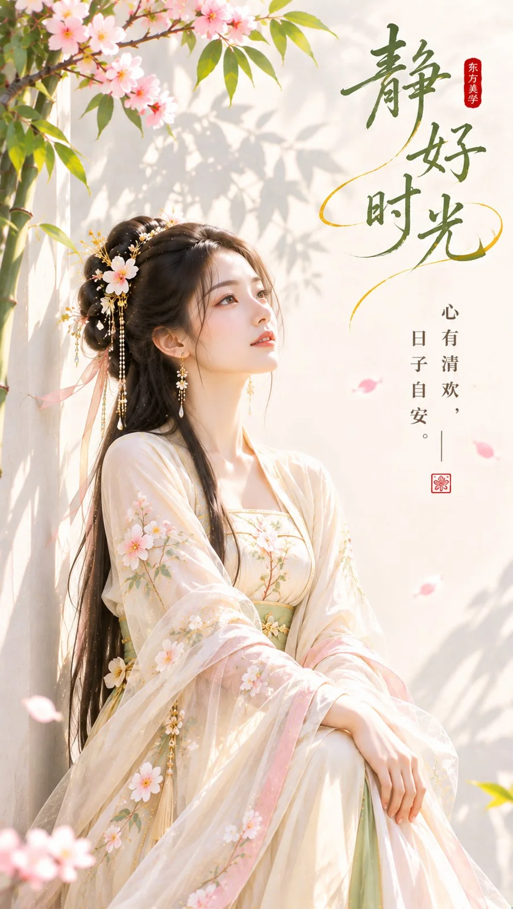

# Eastern Zen Cover Poster: Quiet Good Hours (9:16)

**中文标题：** 东方禅意封面海报：静好时光（9:16）  
**ID:** `gi25-x-1561` · **Mode:** `generate`  
**Categories:** `poster-typography`, `general`  
**Tags:** `x-twitter`, `community`, `gpt-image-2.5`, `x-direct`, `zh`



### Eastern Zen Cover Poster: Quiet Good Hours (9:16)

```text
9:16竖版，东方禅意极简女性封面海报，现代新中式审美，明亮、通透、柔和、精致，高颜值女性向封面。

一位24–27岁的成年东方女性，精致柔和的鹅蛋脸，清亮杏眼，淡妆，白皙自然肤质。深棕黑色长发半盘发，少量白花与浅金发簪点缀。

人物坐在暖白墙边，身体轻微侧转，双腿自然收拢，一只手自然搭在膝盖上，另一只手轻放前方，微微抬头望向右上方，神情安静、松弛、温柔。肩颈、手臂、手腕和手指结构自然协调。

人物穿珍珠白与浅杏色古风襦裙，外罩轻薄宽袖纱衣，局部带少量桃粉花枝与浅绿叶片刺绣，服装轻盈精致但不过度华丽。

背景为大面积暖白墙面，左侧少量竹枝与竹影，少量桃粉花瓣飘落。人物位于中下部偏左，占画面高度约60%，右上方保留大面积连续留白用于标题。

色彩控制：暖白为主基底，青竹绿只用于竹叶与少量服饰细节，桃粉只用于花瓣点睛，浅金只用于发饰；颜色各自归位，禁止整图粉绿化、发灰、发黄。

明亮自然侧光，竹影清晰，人物面部柔亮，发丝和薄纱有轻微轮廓光，整体干净、通透、有呼吸感。

留白处加入东方艺术标题：
「静好时光」
副文案：
「心有清欢，日子自安。」
搭配一枚小型朱红印章。

负面约束：不要人物比例异常，不要肩臂反转，不要多手多指，不要手指畸形，不要网红脸，不要灰雾，不要脏黄，不要复杂背景，不要满屏花朵。
```

- **Recommended model:** `gpt-image-2.5-flare`
- **Settings:** _(defaults)_
- **Source:** [community](https://x.com/liyue_ai/status/2122230873345101904) — @liyue_ai
- **License note:** Original public X post; quoted with attribution — remix with attribution
- **Notes:** Collected directly from X; original post https://x.com/liyue_ai/status/2122230873345101904; post text names GPT Image 2.5; discovered via X search, prompt re-verified against the original X post via api.fxtwitter.com; verified=True; post names GPT Image 2.5 without a Flare/Sunburst variant
- **Preview:** `previews/gi25-x-1561.webp`
