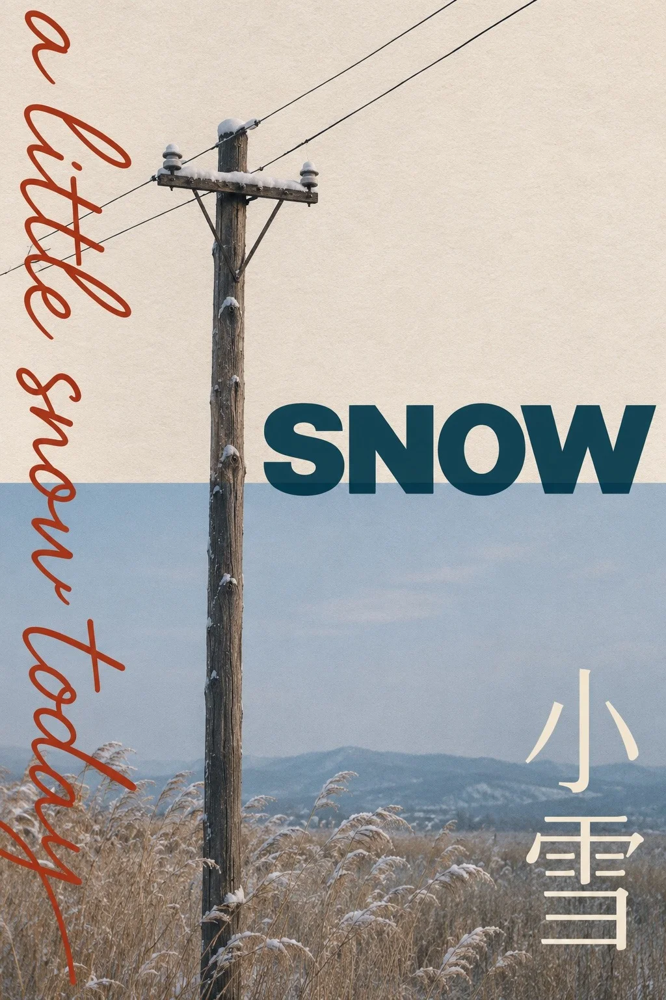

# Japanese Magazine Solar-Term Poster: Light Snow Over Reeds (2:3)

**中文标题：** 日系杂志节气海报：芦苇田边的小雪（2:3）  
**ID:** `gi25-x-1564` · **Mode:** `generate`  
**Categories:** `poster-typography`, `general`  
**Tags:** `x-twitter`, `community`, `gpt-image-2.5`, `x-direct`, `zh`



### Japanese Magazine Solar-Term Poster: Light Snow Over Reeds (2:3)

```text
Create an image with the following visual system. Replace the subject as specified.

Visual system (light, color, composition, medium, mood):
【画面风格】一张竖幅约 2:3 的日系杂志风海报，是实景照片加排版，不是插画。画面上半约 45% 是带细纸纹的米白色纸面，下半是一张实景摄影照片，照片和纸面之间是一条水平的直边分界。照片里有一个竖向的主体从下面一直伸进上半的纸面，伸出来的部分也保持照片质感，像海报的骨架。一个深青蓝色的粗体无衬线英文大词横排在画面中部偏右，正好压在纸面和照片的分界线上，字的下半截落在照片里。画面左侧有一行很大的砖红色英文手写花体，竖着沿左边从上往下写，笔画流畅，局部压在照片主体上。右下的照片区域里，两个米白色的大号汉字竖排，细黑体，干净醒目。照片是自然光，饱和度偏低，带一点胶片颗粒，天空通透。色彩只用米白、深青蓝、砖红三种加照片本身的颜色。文字只允许主体里指定的三处，必须逐字照写、拼写正确，不要多出别的字，不要日期、小字段落、网址、品牌和 logo。留白充足，安静，像一本冬天的杂志封面。

New subject:
【主体】小雪。照片是冬天田野边的一排芦苇和一根老木电线杆，芦苇顶上落着薄薄一层雪，天空是淡淡的蓝灰色，远处一条低低的山线。电线杆从照片底部伸进上方的纸面。文字三处：深青蓝粗体大词「SNOW」；砖红手写「a little snow today」；竖排汉字「小雪」。全图只有这三处文字。
```

- **Recommended model:** `gpt-image-2.5-flare`
- **Settings:** _(defaults)_
- **Source:** [community](https://x.com/static_stare/status/2122265674693427433) — @static_stare
- **License note:** Original public X post; quoted with attribution — remix with attribution
- **Notes:** Collected directly from X; original post https://x.com/static_stare/status/2122265674693427433; post text names GPT Image 2.5; discovered via X search, prompt re-verified against the original X post via api.fxtwitter.com; verified=True; visual-system + replaceable-subject template; prompt for image 1 of 4 (the author offers the other three on request); post names GPT Image 2.5 without a Flare/Sunburst variant; preview is image 1
- **Preview:** `previews/gi25-x-1564.webp`
