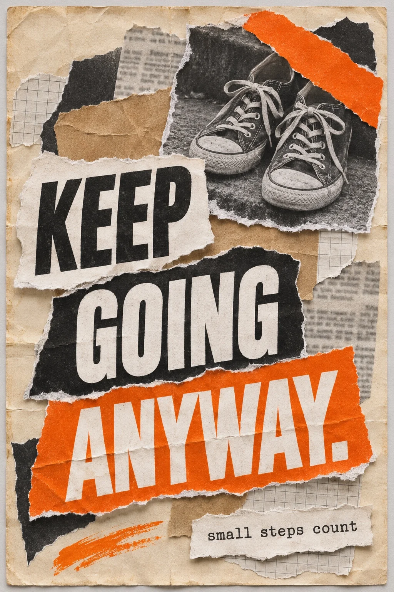

# Torn-Paper Collage Slogan Poster: KEEP GOING ANYWAY. (2:3)

**中文标题：** 撕纸拼贴口号海报：KEEP GOING ANYWAY.（2:3）  
**ID:** `gi25-x-1574` · **Mode:** `generate`  
**Categories:** `poster-typography`, `general`  
**Tags:** `x-twitter`, `community`, `gpt-image-2.5`, `x-direct`, `zh`



### Torn-Paper Collage Slogan Poster: KEEP GOING ANYWAY. (2:3)

```text
Create an image with the following visual system. Replace the subject as specified.

Visual system (light, color, composition, medium, mood):
【画面风格】一张竖幅约 2:3 的撕纸拼贴编辑式海报，平放在浅灰白的墙面上拍摄，海报四周露出一圈浅灰边，海报本身是带轻微折痕和泛黄感的米白旧纸。画面由很多撕开的纸片一层层叠贴而成：毛边白纸条、黑色卡纸、牛皮纸、方格纸、旧报纸的印刷纹理块、黑白老照片的剪片。主口号是粗体压缩无衬线的英文大写字母，分成三行，每行单独贴在一块撕下来的纸片上，纸片颜色在白底黑字、黑底白字、主色底白字之间交替，各行略微倾斜、左右错位，纸片边缘有撕裂的毛边和白色纸纤维。画面右上区域贴一张黑白剪片照片作为主要图像元素，被一条主色撕纸条斜着盖住一角。另有一张小的白色毛边纸条贴在右下，上面是一行打字机字体的小写英文。整张只用黑、白、米白、牛皮纸棕和一种主色，主色以两三块撕纸和一道手绘涂抹笔触出现。光线是均匀柔和的顶光，纸片之间有细小真实的投影，能看出纸的厚度和纤维。可读文字只允许主体里指定的两处，必须逐字照写、拼写正确、字母不多不少；其他纸片上的印刷纹理一律是模糊不可读的灰色小字块；不要日期、签名、手写小字、网址、品牌、logo 和真实人物。

New subject:
【主体】主色：亮橙色。口号三行：「KEEP」「GOING」「ANYWAY.」。黑白剪片照片：一双系着鞋带的旧帆布跑鞋。打字机纸条：「small steps count」。全图只有这两处可读文字。
```

- **Recommended model:** `gpt-image-2.5-flare`
- **Settings:** _(defaults)_
- **Source:** [community](https://x.com/static_stare/status/2122625664062787806) — @static_stare
- **License note:** Original public X post; quoted with attribution — remix with attribution
- **Notes:** Collected directly from X; original post https://x.com/static_stare/status/2122625664062787806; post text names GPT Image 2.5; discovered via X search, prompt re-verified against the original X post via api.fxtwitter.com; verified=True; visual-system + replaceable-subject template; prompt for image 1 of 4 (the author offers the other three on request); post names GPT Image 2.5 without a Flare/Sunburst variant; preview is image 1
- **Preview:** `previews/gi25-x-1574.webp`
