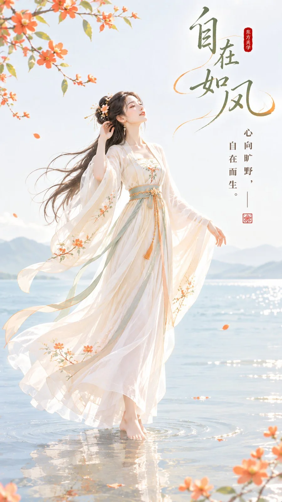

# Eastern Zen Poster: Free as the Wind (9:16)

**中文标题：** 东方禅意海报：自在如风（9:16）  
**ID:** `gi25-x-1575` · **Mode:** `generate`  
**Categories:** `poster-typography`  
**Tags:** `x-twitter`, `community`, `gpt-image-2.5`, `x-direct`, `zh`



### Eastern Zen Poster: Free as the Wind (9:16)

```text
9:16竖版，东方禅意极简女性海报，清透明快型，现代东方插画与高精度人物写真融合，明亮、通透、舒展、有呼吸感。

一位24–27岁的成年东方女性，近全身构图，站在清浅湖水中，身体自然舒展，一手轻扶被风吹起的长发，另一只手自然下垂，衣摆、长袖与发丝随风向同一方向轻轻扬起。人物微微抬头，神情安静、自由、清醒，五官柔美耐看，姿态优雅自然。

人物穿珍珠白与浅米白古风长裙，轻薄宽袖与层叠纱裙具有自然透光感，局部点缀极少珊瑚橙花枝刺绣和浅青绿细节。

场景为开阔浅水面，湖蓝色集中在水面，远处只有极淡山线，水面保留少量细小波纹、阳光反光和人物倒影。画面边缘点缀少量珊瑚橙小花与飘落花瓣，不形成花海。

人物位于画面中央偏下，占画面高度约65%，作为第一视觉中心；远景保持极简，上方和右侧保留大面积自然留白。

色彩控制：珍珠白为人物与高明度空间基底，湖蓝只用于水面，珊瑚橙只用于少量花朵与反光点睛，浅青绿只用于极少服饰细节；禁止整图蓝橙滤镜化。

明亮自然日光，水面清亮，人物轮廓清晰，发丝、薄纱和衣摆有轻柔逆光，整体干净轻盈。

留白处加入东方艺术标题：
「自在如风」
副文案：
「心向旷野，自在而生。」
搭配一枚小型朱红印章「东方美学」。

负面约束：不要人物比例异常，不要手臂反转，不要多手多指，不要头发和衣摆风向冲突，不要灰雾，不要脏蓝，不要过曝，不要复杂山水，不要水面抢主体。
```

- **Recommended model:** `gpt-image-2.5-flare`
- **Settings:** _(defaults)_
- **Source:** [community](https://x.com/liyue_ai/status/2122631475707400452) — @liyue_ai
- **License note:** Original public X post; quoted with attribution — remix with attribution
- **Notes:** Collected directly from X; original post https://x.com/liyue_ai/status/2122631475707400452; post text names GPT Image 2.5; discovered via X search, prompt re-verified against the original X post via api.fxtwitter.com; verified=True; post names GPT Image 2.5 without a Flare/Sunburst variant
- **Preview:** `previews/gi25-x-1575.webp`
