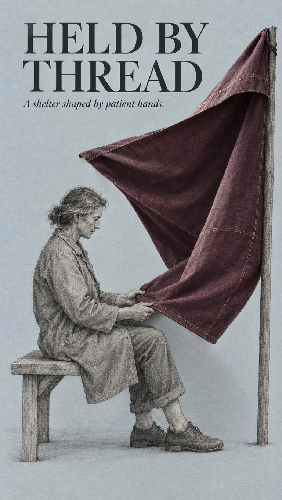

# Mixed-Media Editorial Poster: Sailcloth and a Graphite Sailmaker (9:16)

**中文标题：** 综合媒材编辑海报：帆布与铅笔绘的造帆人（9:16）  
**ID:** `gi25-x-1582` · **Mode:** `generate`  
**Categories:** `poster-typography`, `general`  
**Tags:** `x-twitter`, `community`, `gpt-image-2.5`, `x-direct`, `en`



### Mixed-Media Editorial Poster: Sailcloth and a Graphite Sailmaker (9:16)

```text
Create a premium vertical 9:16 mixed-media editorial poster combining photorealistic sailcloth with a refined graphite drawing. The one illustrated subject is a wholly fictional adult sailmaker in their fifties, wearing a plain long work coat and rolled trousers, seated sideways on a simple sketched bench. Their face is shown in quiet profile with a concentrated expression. Draw the person, clothing and bench in black graphite with delicate shading, mature proportions and natural joints.

A broad piece of muted aubergine sailcloth rises from the person's lap and folds into a small canopy above the bench. The adult holds its lower edge with both hands. The real fabric must emerge convincingly from the drawn contact points and overlap the pencil contours without obscuring the face or hands. Its weight is supported by the held edge and a plainly drawn upright support beside the bench. Do not let the cloth float without support.

Render the sailcloth with photographic fiber detail, visible seams, substantial thickness, soft creases and controlled highlights. Keep the fabric colored and physically real while the person remains graphite, rather than blending everything into a photograph. The cloth is the main sculptural shape, occupying roughly half the composition, with clear negative space around the seated figure.

Use a pale blue-gray paper background with subtle tooth, softly directional studio light and convincing shadows at each point where fabric meets drawing. Aubergine is the dominant accent, with charcoal pencil and a restrained warm off-white edge light. The atmosphere is a quiet indoor material study, not a coastal travel scene.

Set the exact headline "HELD BY THREAD" in large, elegant, high-contrast serif lettering. Below it add "A shelter shaped by patient hands." in smaller italic text. Let one cloth edge overlap the headline margin while preserving every letter's readability. Add no other words.

No fully photorealistic people, cartoon exaggeration, glossy synthetic cloth, distorted hands, brands, logos, watermarks, decorative numbering or glass effects. The fabric feels real, the figure stays drawn, and their physical contact explains the scene.
```

- **Recommended model:** `gpt-image-2.5-flare`
- **Settings:** _(defaults)_
- **Source:** [community](https://x.com/Alyssa4aicreate/status/2122894219090038954) — @Alyssa4aicreate
- **License note:** Original public X post; quoted with attribution — remix with attribution
- **Notes:** Collected directly from X; original post https://x.com/Alyssa4aicreate/status/2122894219090038954; post text names GPT Image 2.5; discovered via X search, prompt re-verified against the original X post via api.fxtwitter.com; verified=True; made with Token360 · GPT Image 2.5 Flare; exact on-image headline 'HELD BY THREAD'; the post ends with the signature line 'Larus Canus'
- **Preview:** `previews/gi25-x-1582.webp`
