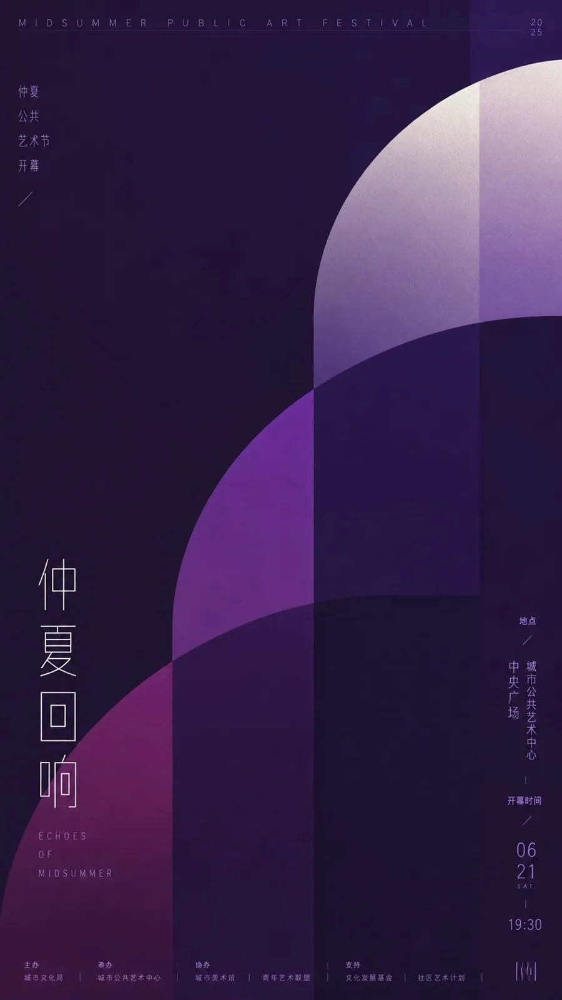

# Geometric Festival Poster: Cropped Glowing Discs on Deep Red

**中文标题：** 节庆几何海报：深红幕上被切开的发光圆盘  
**ID:** `gi25-x-1587` · **Mode:** `generate`  
**Categories:** `poster-typography`, `general`  
**Tags:** `x-twitter`, `community`, `gpt-image-2.5`, `x-direct`, `zh`



### Geometric Festival Poster: Cropped Glowing Discs on Deep Red

```text
第一眼以深浅红色块铺满画面，巨大的圆、半圆与被裁切的弧面相互遮挡，像一枚被垂直切开的发光圆盘嵌入厚重红幕之中；主题形象被抽象为几何天体或建筑投影，只保留圆弧、直边、压暗阴影和局部柔光的关系，不写实堆砌。画面以大面积暗红作底，叠加酒红、猩红、砖红的平面块，少量奶黄色到淡粉紫的柔和渐变只出现在关键半圆或底部弧面，形成克制的节庆光感。版式保持强烈留白与偏置构图：主要文字成窄列竖排，字距舒展，靠近几何重心但不居中；辅助信息压低、缩小，沿边缘或底部形成细密信息带。字体机制为瘦长、硬朗、低装饰的现代印刷骨架，笔画均匀，端点干净，字腔开阔，纵向节奏稳定，标记与数字也服从细线、紧排、低对比的秩序。所有元素像广告印刷品一样平整、无厚重质感，边界清晰但色块之间有轻微压暗、套印感和透明叠色，保留商业物料的克制、规整与少量机械误差，不加入华丽纹样、立体渲染、烟雾、金属、过度光效或插画化人物。
```

- **Recommended model:** `gpt-image-2.5-flare`
- **Settings:** _(defaults)_
- **Source:** [community](https://x.com/xiaoxiaodong/status/2122978280970002744) — @xiaoxiaodong
- **License note:** Original public X post; quoted with attribution — remix with attribution
- **Notes:** Collected directly from X; original post https://x.com/xiaoxiaodong/status/2122978280970002744; post text names GPT Image 2.5; discovered via X search, prompt re-verified against the original X post via api.fxtwitter.com; verified=True; post names GPT2 x (the author's shorthand for GPT Image 2.5) without a Flare/Sunburst variant; the published prompt is the fenced '提示词汤底'; preview is image 1 of 4
- **Preview:** `previews/gi25-x-1587.webp`
