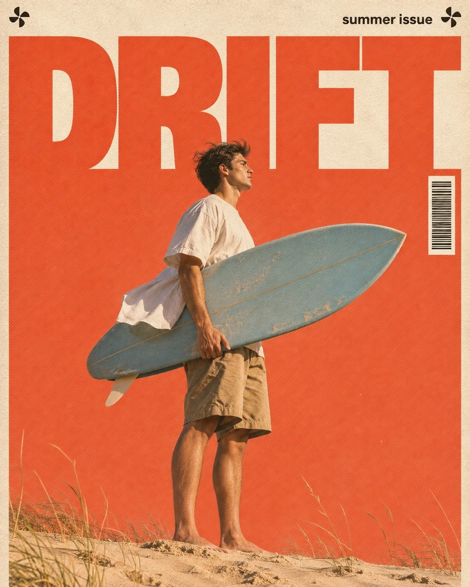

# Vintage Magazine Cover: DRIFT and a Surfer (4:5)

**中文标题：** 复古杂志封面：DRIFT 与冲浪者（4:5）  
**ID:** `gi25-x-1588` · **Mode:** `generate`  
**Categories:** `poster-typography`, `general`  
**Tags:** `x-twitter`, `community`, `gpt-image-2.5`, `x-direct`, `zh`



### Vintage Magazine Cover: DRIFT and a Surfer (4:5)

```text
Create an image with the following visual system. Replace the subject as specified.

Visual system (light, color, composition, medium, mood):
【画面风格】一张竖幅约 4:5 的复古杂志封面式海报。整张底是米白色旧纸，带细密的斜纹网点和轻微的纸纤维肌理。画面上部横跨整个宽度排着一个超大的粗黑无衬线英文大写单词，字母又宽又重、字距很紧，单词的下半截被一块从画面中部一直铺到底部的纯色大色块接住，字和色块是同一个颜色，看上去像字从色块里长出来；色块左右两边各留一条窄窄的米白纸边。色块里是一张真实摄影的人物：一个人全身或七分身站在色块前，低机位略微仰拍，人物上半身压住大单词的下沿，色块本身就像晴朗干净的天空，画面最底部是一道真实的地面，压住色块下沿。人物衣服的颜色和主色形成对比，阳光从侧面照过来，皮肤和布料有自然的高光和清楚的影子，风把头发或衣角吹起一点。大单词右上方有一行很小的黑色无衬线小写字；色块右侧边缘贴一个白底竖条码图形，只有黑色竖线，没有数字；左上角和右上角各有一个小小的黑色风车形装饰符号。色彩：米白纸底、一种主色色块、人物衣服一块对比色，整体干净，带一点复古胶片的颗粒。可读文字只允许主体里指定的两处：大单词和那一行小字，必须逐字照写、拼写正确、字母不多不少；不要日期、署名、网址、品牌、logo，不要其他任何字母或数字。

New subject:
【主体】主色：暖珊瑚橙。大单词：「DRIFT」。小字：「summer issue」。人物：一个短发的年轻男人，穿宽松白 T 恤和卡其色短裤，侧身抱着一块浅蓝色冲浪板看向远处。脚下是一道浅色沙丘和几根海边干草。全图只有这两处可读文字。
```

- **Recommended model:** `gpt-image-2.5-flare`
- **Settings:** _(defaults)_
- **Source:** [community](https://x.com/static_stare/status/2122989005356810664) — @static_stare
- **License note:** Original public X post; quoted with attribution — remix with attribution
- **Notes:** Collected directly from X; original post https://x.com/static_stare/status/2122989005356810664; post text names GPT Image 2.5; discovered via X search, prompt re-verified against the original X post via api.fxtwitter.com; verified=True; visual-system + replaceable-subject template; prompt for image 1 of 4 (the author offers the other three on request); post names GPT Image 2.5 without a Flare/Sunburst variant; preview is image 1
- **Preview:** `previews/gi25-x-1588.webp`
