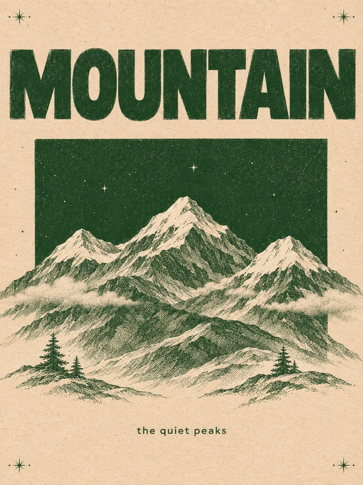

# Monochrome Letterpress Poster: MOUNTAIN and Engraved Peaks (3:4)

**中文标题：** 单色纸纹海报：MOUNTAIN 与铜版画雪山（3:4）  
**ID:** `gi25-x-1601` · **Mode:** `generate`  
**Categories:** `poster-typography`, `general`  
**Tags:** `x-twitter`, `community`, `gpt-image-2.5`, `x-direct`, `zh`



### Monochrome Letterpress Poster: MOUNTAIN and Engraved Peaks (3:4)

```text
Create an image with the following visual system. Replace the subject as specified.

Visual system (light, color, composition, medium, mood):
【画面风格】一张竖幅约 3:4 的单色印刷海报，整张底是米色旧纸，带细小的纸纤维、轻微的斑点和一点点印刷错位感。整张图只用一种主色加米色纸底，主色有深浅两三个层次，像一次只印了一种油墨的丝网版画。画面上部横排一个超大的粗体无衬线英文大写单词，字母又宽又重，几乎撑满整个宽度，颜色是主色。单词下面是画面的主视觉：一个占画面一半以上的大图案，用复古铜版画那种细密的排线和点刻画出来，有明暗和体积；图案后面垫一块主色的长方形色块，图案的边缘超出色块，压在米色纸上，色块周围撒着一些主色的小星点和细碎颗粒。四个角各有一个小小的主色装饰符号（细线放射小星、小圆点、小月牙这类），很克制。图案下方居中是一行很小的无衬线英文小写字，主色。版式对称、留白干净，有日系杂货店海报的安静感。可读文字只允许主体里指定的两处：大单词和那一行小字，必须逐字照写、拼写正确、字母不多不少；不要任何日文、中文、竖排小字、段落小字、日期、网址、品牌和 logo，不要其他任何字母或数字。

New subject:
【主体】主色：墨绿色。大单词：「MOUNTAIN」。小字：「the quiet peaks」。主视觉：一座连绵的雪山，三个山峰，山顶有积雪，山腰有一层薄云和几棵小松树，用铜版画排线刻出山体的明暗。全图只有这两处可读文字。
```

- **Recommended model:** `gpt-image-2.5-flare`
- **Settings:** _(defaults)_
- **Source:** [community](https://x.com/static_stare/status/2123351433281982542) — @static_stare
- **License note:** Original public X post; quoted with attribution — remix with attribution
- **Notes:** Collected directly from X; original post https://x.com/static_stare/status/2123351433281982542; post text names GPT Image 2.5; discovered via X search, prompt re-verified against the original X post via api.fxtwitter.com; verified=True; visual-system + replaceable-subject template; prompt for image 1 of 4 (the author offers the other three on request); post names GPT Image 2.5 without a Flare/Sunburst variant; preview is image 1; exact on-image text is 'MOUNTAIN' and 'the quiet peaks'
- **Preview:** `previews/gi25-x-1601.webp`
