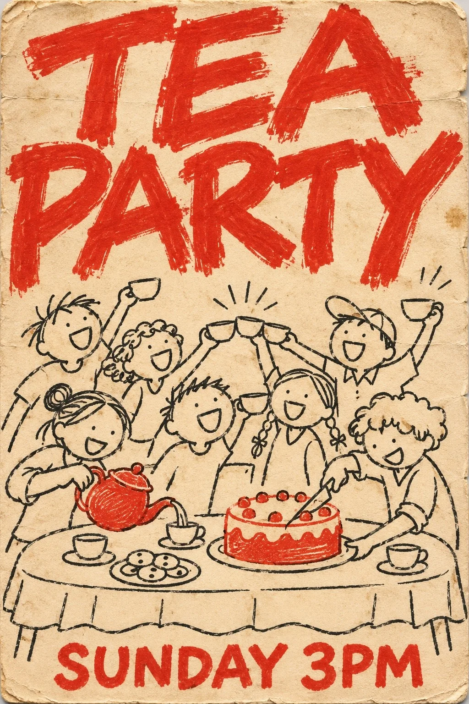

# Handmade Lettering Poster: TEA PARTY Line Figures on Aged Paper

**中文标题：** 手写大字聚会海报：做旧纸上的 TEA PARTY 线条小人  
**ID:** `gi25-x-1616` · **Mode:** `generate`  
**Categories:** `poster-typography`, `general`  
**Tags:** `x-twitter`, `community`, `gpt-image-2.5`, `x-direct`, `zh`



### Handmade Lettering Poster: TEA PARTY Line Figures on Aged Paper

```text
Create an image with the following visual system. Replace the subject as specified.

Visual system (light, color, composition, medium, mood):
【画面风格】一张竖幅约 2:3 的手绘活动海报，整张底是做旧的米黄色纸，带细小折痕、纸纤维、边角轻微磨损和淡淡的污渍，像贴在墙上很久的传单被扫描下来。画面上部是一个超大的手写英文标题，番茄红色，用粗马克笔写的歪歪扭扭的大写字母，笔画粗细不均、边缘有一点干笔和飞白，分两行占满上方三分之一，字母之间挤在一起，很有劲。中间大片是黑色细线条手绘的一群简笔小人和物件，线条像钢笔随手画的，粗细一致、有点抖，人物是圆脑袋、豆豆眼、大笑的嘴，没有上色，只有个别小物件用同样的番茄红点一点色；小人们挤在一起、互相搭肩、举着东西，热闹又随意，画面里的物件上不出现任何字母或数字。画面最下方居中是一行中等大小的番茄红粗体无衬线英文，像手写印章字。整张只有番茄红、黑线和米黄纸三种颜色，红色印刷有一点点套色错位。可读文字只允许主体里指定的两处：大标题和底部那一行，必须逐字照写、拼写正确、字母不多不少；不要价格、电话、网址、地址、品牌、logo、段落小字和其他任何字母或数字。

New subject:
【主体】大标题：「TEA PARTY」（TEA 一行，PARTY 一行）。底部一行：「SUNDAY 3PM」。线条小人：七八个小人围着一张长桌，举着茶杯碰杯，桌上有大茶壶、一整个蛋糕和一盘小饼干，有人在倒茶，有人在切蛋糕，茶壶和蛋糕用番茄红点色。全图只有这两处可读文字。
```

- **Recommended model:** `gpt-image-2.5-flare`
- **Settings:** _(defaults)_
- **Source:** [community](https://x.com/static_stare/status/2123714164522979557) — @static_stare
- **License note:** Original public X post; quoted with attribution — remix with attribution
- **Notes:** Collected directly from X; original post https://x.com/static_stare/status/2123714164522979557; post text names GPT Image 2.5; discovered via X search, prompt re-verified against the original X post via api.fxtwitter.com; verified=True; visual-system + replaceable-subject template; prompt for image 1 of 4 (the author offers the other three on request); post names GPT Image 2.5 without a Flare/Sunburst variant; preview is image 1; exact on-image text is 'TEA PARTY' and 'SUNDAY 3PM'
- **Preview:** `previews/gi25-x-1616.webp`
