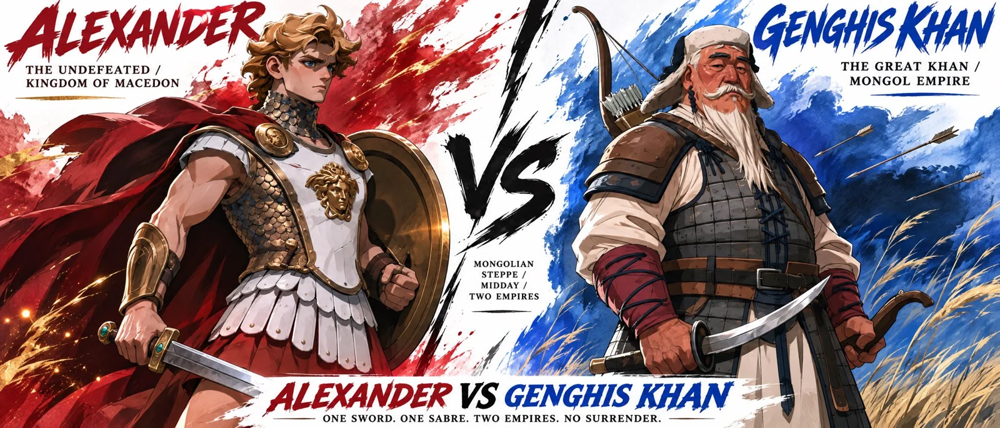

# Character Bible VS Sheet: Alexander the Great vs Genghis Khan

**中文标题：** 角色设定对打页：亚历山大大帝 vs 成吉思汗  
**ID:** `gi25-x-1618` · **Mode:** `generate`  
**Categories:** `poster-typography`, `general`  
**Tags:** `x-twitter`, `community`, `gpt-image-2.5`, `x-direct`, `en`



### Character Bible VS Sheet: Alexander the Great vs Genghis Khan

```text
Create a premium cinematic character bible sheet for ALEXANDER THE GREAT VS GENGHIS KHAN.
LAYOUT: Split screen VS format. Two halves divided by a bold dramatic dividing element in the center.
LEFT SIDE — ALEXANDER THE GREAT: Bold dramatic crimson watercolor splash radiating behind him, filling the entire left side, with streaks of gold and flying golden sparks. Large bold brushstroke text ALEXANDER top left in crimson. Below, small text: THE UNDEFEATED / KINGDOM OF MACEDON. One massive dramatic cropped hero image of Alexander from mid-thigh up: young, athletic build, thick wavy golden-brown hair swept back like a lion's mane, bright blue eyes, clean-shaven, no helmet, a white layered linen breastplate with bronze scale panels and a golden Medusa head on the chest, a bronze scale neck guard, a red tunic, a deep crimson cloak flowing behind him, holding a short straight sword in his right hand with a round bronze shield on his left arm, intense confident expression.
CENTER: Bold dramatic VS in deep black. Below it, small text: MONGOLIAN STEPPE / MIDDAY / TWO EMPIRES.
RIGHT SIDE — GENGHIS KHAN: Bold dramatic deep royal-blue watercolor splash radiating behind him, filling the entire right side, deep blue bleeding into black, with streaks of wind-blown grass and flying arrows. Large bold brushstroke text GENGHIS KHAN top right in royal blue. Below, small text: THE GREAT KHAN / MONGOL EMPIRE. One massive dramatic cropped hero image of Genghis Khan from mid-thigh up: stocky, broad, older build, a broad weathered face, a long white mustache and long thin white beard, braided loops of hair behind his ears, a white felt cap with dark fur trim, dark iron lamellar armour laced with blue cords over a cream-white long coat, brown leather shoulder guards, a bow and quiver on his back, holding a curved sabre low at his side, cold, calm, patient expression.
BOTTOM CENTER: Bold text ALEXANDER VS GENGHIS KHAN, with ALEXANDER in crimson, VS in deep black and GENGHIS KHAN in royal blue. Tagline: ONE SWORD. ONE SABRE. TWO EMPIRES. NO SURRENDER.
OVERALL: Clean white background, bold dramatic crimson and gold watercolor explosion on the left side, bold dramatic royal blue and black watercolor explosion on the right side, dramatic deep black center divider, bold flat color blocking, chunky simplified forms, hard edge shadows, thick black outlines, cinematic cel-shaded 3D anime, hand-painted textures, not cartoon, not Disney, not Pixar, print ready.
```

- **Recommended model:** `gpt-image-2.5-flare`
- **Settings:** _(defaults)_
- **Source:** [community](https://x.com/TechieBySA/status/2123778791872843932) — @TechieBySA
- **License note:** Original public X post; quoted with attribution — remix with attribution
- **Notes:** Collected directly from X; prompt posted as the author's own reply https://x.com/TechieBySA/status/2123778791872843932 to https://x.com/TechieBySA/status/2123778566240239915, which carries the images; GPT Image 2.5 is named in the parent post; discovered via X search, prompt re-verified against the original X post via api.fxtwitter.com; verified=True; prompt posted as the author's self-reply; the reply text itself names GPT Image 2.5 without a Flare/Sunburst variant; the root post also names GPT Image 2.5 (alongside a Seedance 2.5 video prompt, which is not stored)
- **Preview:** `previews/gi25-x-1618.webp`
