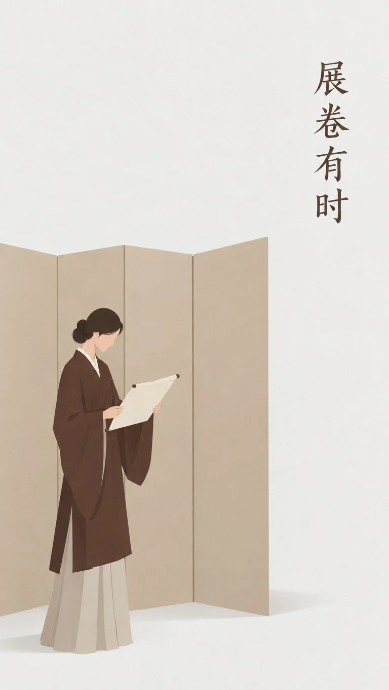

# Minimal Eastern Poster: 展卷有时, a Woman with a Blank Scroll (9:16)

**中文标题：** 东方极简封面海报：展卷有时（9:16）  
**ID:** `gi25-x-1627` · **Mode:** `generate`  
**Categories:** `poster-typography`, `general`  
**Tags:** `x-twitter`, `community`, `gpt-image-2.5`, `x-direct`, `zh`



### Minimal Eastern Poster: 展卷有时, a Woman with a Blank Scroll (9:16)

```text
一张九比十六竖版东方极简封面海报，背景为干净的淡灰白色。一位完全虚构的成年女性位于左下方，穿着深栗色不透肤宽袖长衫与米灰长裙，站在一扇暖砂色的简洁折屏旁，双手在身前展开没有文字的素色卷轴，低头阅读。人物用平面色块描绘，不做精致美妆特写。

折屏与人物集中在画面左下及中部，折屏只有清楚的竖向折线，不加花纹。右上方保留完整留白，用清楚的中文竖排写「展卷有时」，不加其他文字。配色为淡灰白、暖砂与深栗，饰物全部省去。柔和自然光、清晰边缘、极少量地面投影，呈现安静的印刷海报质感。不要真实人物、品牌、标志、水印或密集装饰。
```

- **Recommended model:** `gpt-image-2.5-flare`
- **Settings:** _(defaults)_
- **Source:** [community](https://x.com/Andy4aicreate/status/2124208196990783980) — @Andy4aicreate
- **License note:** Original public X post; quoted with attribution — remix with attribution
- **Notes:** Collected directly from X; original post https://x.com/Andy4aicreate/status/2124208196990783980; post text names GPT Image 2.5; discovered via X search, prompt re-verified against the original X post via api.fxtwitter.com; verified=True; post names GPT Image 2.5 Flare; exact on-image text is '展卷有时'
- **Preview:** `previews/gi25-x-1627.webp`
