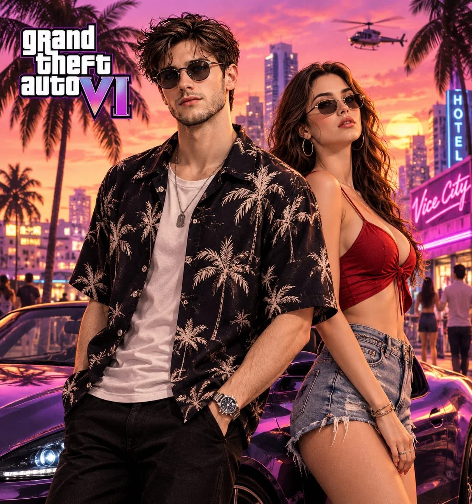

# GTA 6 Vice City Cinematic Couple Poster

**中文标题：** GTA 6 Vice City 电影感双人海报  
**ID:** `gi25-x-1629` · **Mode:** `generate`  
**Categories:** `poster-typography`, `general`  
**Tags:** `x-twitter`, `community`, `gpt-image-2.5`, `x-direct`, `en`



### GTA 6 Vice City Cinematic Couple Poster

```text
Create an ultra-detailed, cinematic GTA 6-inspired promotional poster featuring a stylish young man and a beautiful young woman standing together in the heart of Vice City, inspired by the vibrant atmosphere and visual aesthetics of Grand Theft Auto VI.

Main Male Character:
Place the young man prominently in the foreground, standing confidently beside a luxurious sports convertible. He has naturally styled dark hair, a neatly groomed beard, sharp facial features, realistic skin texture, and a confident expression. He wears a fashionable oversized designer shirt, premium trousers, stylish sneakers, sunglasses, and a luxury wristwatch.

Female Character:
Position a stylish young woman beside him, slightly behind his shoulder. Give her naturally flowing hair, a fashionable summer outfit, elegant accessories, and a confident cinematic expression. Both characters should look naturally connected, like the central duo of a blockbuster open-world crime adventure.

Environment & Background:

- Beautiful Vice City-inspired tropical Miami atmosphere.
- Tall palm trees lining the streets.
- Luxury hotels and modern skyscrapers.
- A stunning pink, orange and purple sunset.
- A premium convertible sports car parked beside the characters.
- Neon signs, glowing streetlights and colorful city reflections.
- A few distant pedestrians and vehicles to create a realistic city atmosphere.

Composition & Camera:
Use a professional GTA 6 promotional poster composition. Both characters should be clearly visible from approximately the knees upward. Position the male character slightly forward and the female character beside him. Maintain realistic body proportions, natural poses and accurate facial details.

Visual Style:
Blend ultra-realistic human character rendering with the vibrant illustrated aesthetic of GTA 6 promotional artwork. Use rich tropical colors, cinematic shadows, warm sunset lighting, subtle film grain, detailed clothing textures and professional color grading.

Final Quality:
8K ultra-detailed artwork, cinematic masterpiece, sharp facial details, realistic expressions, premium video-game promotional art, balanced composition, vibrant Vice City atmosphere, professional poster design.

Important: Maintain the exact facial identity of the male character from the uploaded reference photo. Do not change his face, hairstyle or defining facial features. Avoid distorted hands, extra fingers, duplicate characters, incorrect facial anatomy, blurry faces or unwanted text.
```

- **Recommended model:** `gpt-image-2.5-flare`
- **Settings:** _(defaults)_
- **Source:** [community](https://x.com/mon010_de/status/2124353994583925027) — @mon010_de
- **License note:** Original public X post; quoted with attribution — remix with attribution
- **Notes:** Collected directly from X; original post https://x.com/mon010_de/status/2124353994583925027; post text names GPT Image 2.5; discovered via X search, prompt re-verified against the original X post via api.fxtwitter.com; verified=True; post names GPT Image 2.5 without a Flare/Sunburst variant
- **Preview:** `previews/gi25-x-1629.webp`
