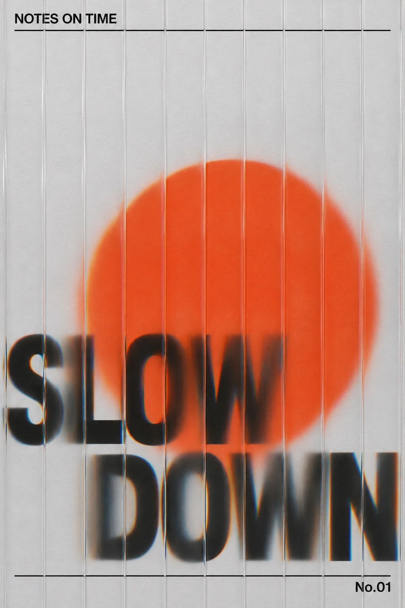

# Fluted-Glass Typography Poster: SLOW DOWN with an Orange Circle

**中文标题：** 长虹玻璃字体海报：SLOW DOWN 与橙色圆  
**ID:** `gi25-x-1644` · **Mode:** `generate`  
**Categories:** `poster-typography`, `general`  
**Tags:** `x-twitter`, `community`, `gpt-image-2.5`, `x-direct`, `zh`



### Fluted-Glass Typography Poster: SLOW DOWN with an Orange Circle

```text
Create an image with the following visual system. Replace the subject as specified.

Visual system (light, color, composition, medium, mood):
【画面风格】一张竖幅约 2:3 的极简瑞士风字体海报，像一张印好的海报被正面平拍下来。底色是带细微颗粒的浅灰白纸面。海报正前方贴着立了一整面长虹玻璃（竖条纹棱镜玻璃），玻璃的竖条纹从上到下等宽排列，每条大约是画面宽度的十分之一，条纹交界处有细细的浅灰高光线。海报中部到下部是一句超大号的黑色粗体无衬线英文大写短句，分成两行，第一行靠左、第二行靠右错开，字大到几乎撑满版面宽度；这些大字是隔着长虹玻璃看到的，所以每一条玻璃里的字都被横向错位、拉宽和模糊，有的条纹里字还算清楚，有的条纹里糊成一片灰，字的边缘带一点点青蓝和橙红的色散彩边，像真实的光学折射，不是简单的整体模糊。大字后面放着主体指定的一个彩色几何色块，也隔着玻璃被折射成一条条竖向的彩色光晕，这是全图唯一的颜色。海报顶部有一条细黑横线，横线上方左侧是一行小号黑色无衬线英文大写短句，清晰锐利；海报底部有一条细黑横线，横线下方右侧是一个小号黑色编号，清晰锐利。光是均匀柔和的棚拍光，玻璃表面有极轻的反光。整张只用浅灰白、黑、中灰和主体指定的一个强调色。海报上只允许出现主体里指定的三处文字：大字短句、顶部一行小字、右下编号，必须逐字照写、拼写正确、字母不多不少；不要其他小字、说明栏、日期、网址、署名、logo、品牌和水印。

New subject:
【主体】大字短句两行：第一行「SLOW」，第二行「DOWN」。顶部一行小字：「NOTES ON TIME」。右下编号：「No.01」。大字后面的彩色色块：一个很大的橙红色正圆，位置在画面中间偏右。全图只有这三处文字。
```

- **Recommended model:** `gpt-image-2.5-flare`
- **Settings:** _(defaults)_
- **Source:** [community](https://x.com/static_stare/status/2124799205839606209) — @static_stare
- **License note:** Original public X post; quoted with attribution — remix with attribution
- **Notes:** Collected directly from X; original post https://x.com/static_stare/status/2124799205839606209; post text names GPT Image 2.5; discovered via X search, prompt re-verified against the original X post via api.fxtwitter.com; verified=True; visual-system + replaceable-subject template; prompt for image 1 of 4 (the author offers the other three on request); post names GPT Image 2.5 without a Flare/Sunburst variant; preview is image 1; exact on-image text is 'SLOW', 'DOWN', 'NOTES ON TIME', and 'No.01'
- **Preview:** `previews/gi25-x-1644.webp`
