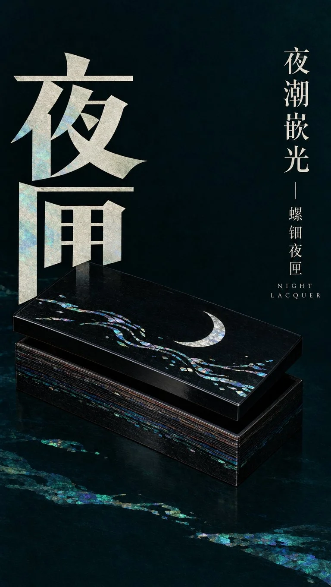

# Contemporary Eastern Exhibition Poster: 螺钿夜匣 / NIGHT LACQUER (9:16)

**中文标题：** 当代东方展览海报：螺钿夜匣（9:16）  
**ID:** `gi25-x-1650` · **Mode:** `generate`  
**Categories:** `poster-typography`, `general`  
**Tags:** `x-twitter`, `community`, `gpt-image-2.5`, `x-direct`, `zh`



### Contemporary Eastern Exhibition Poster: 螺钿夜匣 / NIGHT LACQUER (9:16)

```text
请创作一张九比十六竖版、具有专业设计工作室水准的当代东方文化艺术展览海报。

展览主题：夜潮嵌光。中文主标题：螺钿夜匣。英文主标题：NIGHT LACQUER。核心艺术对象是一只完全虚构的长方形黑漆螺钿匣，匣盖微微掀开，盖面用螺钿镶出一弯冷白新月和几道细碎浪纹，匣身侧面露出细密的漆层断面，没有文字、纹章或可辨认的器物款识。

字体表现：画面左侧重叠两枚巨大的几何感汉字「夜匣」，笔画粗实，部分笔划被漆匣遮挡或从匣盖后方穿过；右侧以细长的纵向粗宋体排布展览主题，字距疏朗。不出现机构名、商标或网址。

背景为深海青与近黑的漆色，局部有螺钿特有的蓝绿虹彩。构图平稳，留出足够的边缘留白，印刷质感清晰，文字必须逐字正确。不出现真实人物、摄影写真、三维渲染或水印。
```

- **Recommended model:** `gpt-image-2.5-flare`
- **Settings:** _(defaults)_
- **Source:** [community](https://x.com/Andy4aicreate/status/2124934011592085845) — @Andy4aicreate
- **License note:** Original public X post; quoted with attribution — remix with attribution
- **Notes:** Collected directly from X; original post https://x.com/Andy4aicreate/status/2124934011592085845; post text names GPT Image 2.5; discovered via X search, prompt re-verified against the original X post via api.fxtwitter.com; verified=True; post names GPT Image 2.5 Flare; exact on-image text is '夜匣', plus the exhibition theme and English title 'NIGHT LACQUER' as specified in the prompt
- **Preview:** `previews/gi25-x-1650.webp`
