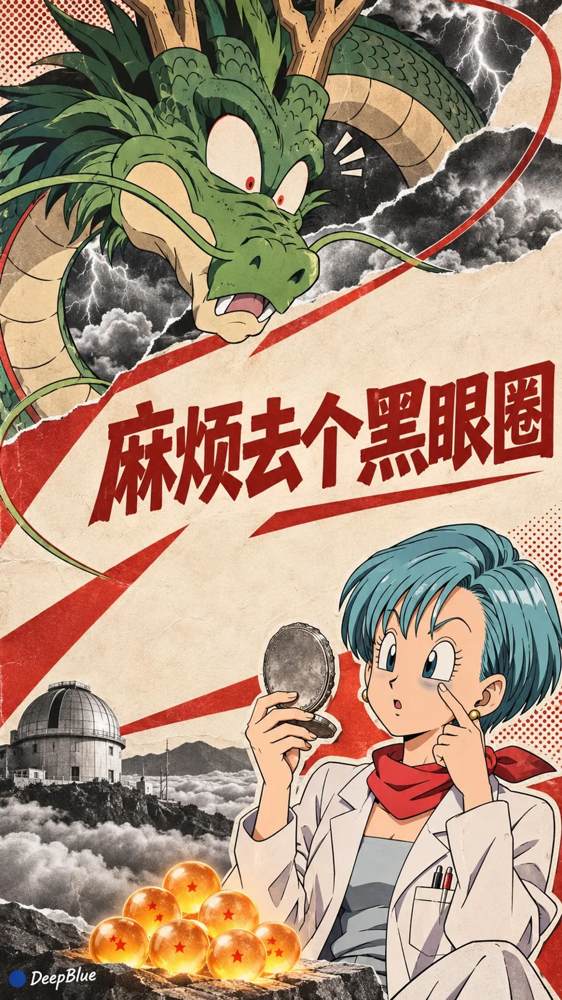

# Constructivist Photo-Collage Propaganda Poster of Anime Character Memes

**中文标题：** 构成主义照片拼贴：二次元角色梗复古宣传海报  
**ID:** `gi25-x-1652` · **Mode:** `generate`  
**Categories:** `poster-typography`, `general`  
**Tags:** `x-twitter`, `community`, `gpt-image-2.5`, `x-direct`, `zh`



### Constructivist Photo-Collage Propaganda Poster of Anime Character Memes

```text
成年二次元女性角色 × 热门角色梗 × 构成主义照片拼贴 × 复古宣传海报。

每张从动漫或游戏中自由抽取一位或多位成年女性角色，以及与她们直接相关、粉丝熟悉的梗。人数、场景、动作和构图随梗自由变化。把最好笑的一瞬画出来，让路人看懂反差，粉丝认出梗。用一句简短的粗体中文标题补上笑点，语气随画面变化。

保留角色标志性造型。用米白旧纸、黑白照片剪贴和朱红几何自由构图，把视线引向最好笑的细节。

9:16 竖版独立单图。左下深蓝色实心圆点，后接白色自然手写体「DeepBlue」。

n=6
```

- **Recommended model:** `gpt-image-2.5-flare`
- **Settings:** _(defaults)_
- **Source:** [community](https://x.com/DeepBlueX0/status/2125038276264571132) — @DeepBlueX0
- **License note:** Original public X post; quoted with attribution — remix with attribution
- **Notes:** Collected directly from X; original post https://x.com/DeepBlueX0/status/2125038276264571132; post text names GPT Image 2.5; discovered via X search, prompt re-verified against the original X post via api.fxtwitter.com; verified=True; post names GPT image 2.5 without a Flare/Sunburst variant; exact on-image text includes a short bold Chinese title plus a lower-left handwritten 'DeepBlue' after a solid navy dot; preview is image 1 of 6
- **Preview:** `previews/gi25-x-1652.webp`
