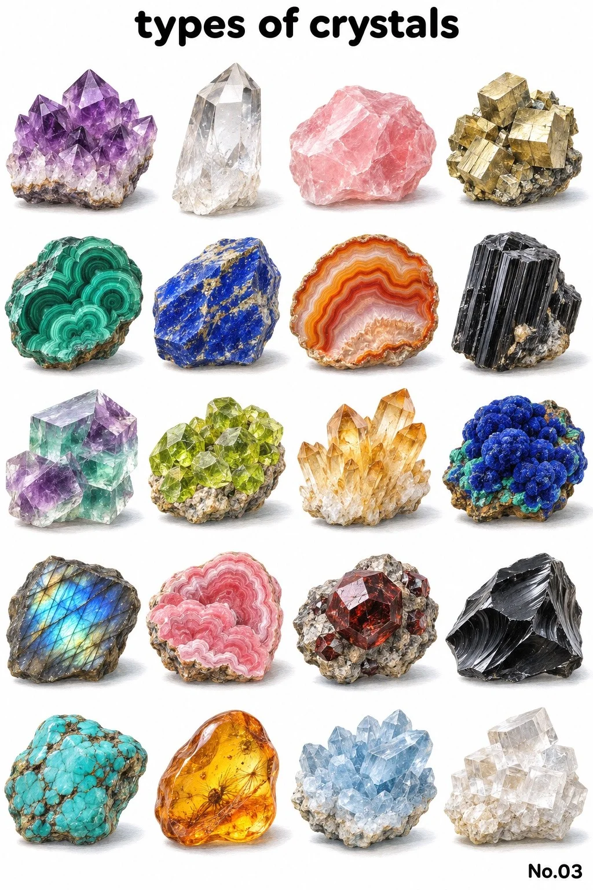

# White-Background Field Guide: Types of Crystals

**中文标题：** 白底博物图鉴：二十块矿石晶体  
**ID:** `gi25-x-1659` · **Mode:** `generate`  
**Categories:** `poster-typography`, `general`  
**Tags:** `x-twitter`, `community`, `gpt-image-2.5`, `x-direct`, `zh`



### White-Background Field Guide: Types of Crystals

```text
Create an image with the following visual system. Replace the subject as specified.

Visual system (light, color, composition, medium, mood):
【画面风格】一张竖幅约 2:3 的白底博物图鉴表，像科普海报或图鉴书里的一整页。底色是干净的纯白，没有纸纹、没有底纹、没有任何淡色水印图案。画面顶部居中是一行黑色粗体圆润的小写英文标题（文字由主体指定），标题下面留一点空。标题下方是整齐的网格：五行、每行四个，一共二十个同一类东西的标本插图（由主体决定），每一个都单独摆放、互不重叠，大小差不多，间距均匀，排得很满但不挤。每个标本都是写实的博物插画画法：细致的水彩加彩铅质感，结构准确，有清楚的纹理、斑点、条纹和颜色渐变，左上方来的柔和光让它们有体积感，正下方带一个很淡的灰色投影，像放在白纸上。二十个标本要各不相同，形状、大小、颜色和花纹都有变化，同一类里尽量排出深浅冷暖的节奏，但整体看起来是一套。标本下面一律不写名字、不配小字标签，网格里只有图没有字，也不要线框和格子线。画面右下角有一个小号黑色编号（文字由主体指定），清晰锐利。整张只有两处文字：顶部标题和右下编号，必须逐字照写、拼写正确、字母不多不少；不要拉丁学名、说明文字、页码、网址、署名、logo、品牌和水印。气氛干净、好认、像随手能存下来查的那种图。

New subject:
【主体】顶部标题：「types of crystals」。右下编号：「No.03」。二十块各不相同的天然矿石和晶体：紫水晶簇、透明白水晶柱、粉色玫瑰石英、黄色黄铁矿立方块、蓝绿色孔雀石、深蓝色青金石、橙红色玛瑙切片、黑色电气石、半透明萤石、绿色橄榄石颗粒等，有的是原石、有的是切开的截面，大小不一。全图只有这两处文字。
```

- **Recommended model:** `gpt-image-2.5-flare`
- **Settings:** _(defaults)_
- **Source:** [community](https://x.com/static_stare/status/2125468811457667289) — @static_stare
- **License note:** Original public X post; quoted with attribution — remix with attribution
- **Notes:** Collected directly from X; prompt posted as the author's own reply https://x.com/static_stare/status/2125468811457667289 to https://x.com/static_stare/status/2125161133804015882, which carries the images; GPT Image 2.5 is named in the parent post; discovered via X search, prompt re-verified against the original X post via api.fxtwitter.com; verified=True; subject block posted as the author's public reply; the visual-system block is copied from the parent post as the author instructed; post names GPT Image 2.5 without a Flare/Sunburst variant; exact on-image text is 'types of crystals' and 'No.03'; preview is image 3 of the parent (minerals/crystals)
- **Preview:** `previews/gi25-x-1659.webp`
