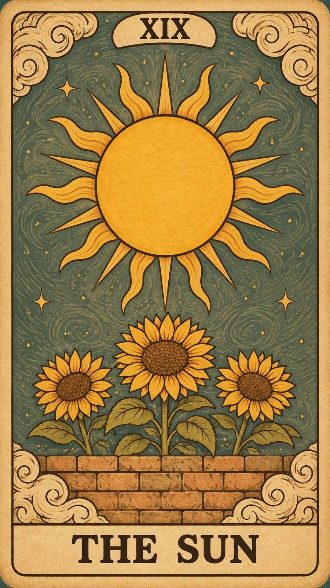

# Retro Tarot Card: The Sun (Visual System)

**中文标题：** 复古塔罗牌：太阳（画面风格模板）  
**ID:** `gi25-x-1675` · **Mode:** `generate`  
**Categories:** `poster-typography`, `general`  
**Tags:** `x-twitter`, `community`, `gpt-image-2.5`, `x-direct`, `zh`



### Retro Tarot Card: The Sun (Visual System)

```text
Create an image with the following visual system. Replace the subject as specified.

Visual system (light, color, composition, medium, mood):
【画面风格】一张竖幅约 9:16 的复古塔罗牌插画，整张就是一张牌的正面，平视正对、居中、左右对称。牌面像印在发黄的旧卡纸上，最外圈是一道米黄色宽边，里面一圈深棕色细线框，四角是圆角。牌的中间是一大块灰青绿色的底，用细细的旋涡状笔触刷出像夜空一样流动的纹理，上面撒着小小的金色圆点和几颗四角星。左上、右上、左下、右下四个角各有一团米白色的卷云，用深棕色线勾出一圈圈螺旋，像装饰纹样，把中间的画面框起来。主图（由主体决定）放在青绿底的正中，占中间约一半的面积，用芥末黄、金黄和奶白平涂，边缘是深棕色的粗描线，暗部只加一层浅橙棕。牌的最上方正中有一块米黄色的拱形小牌匾，里面写这张牌的罗马数字；最下方是一条横跨整张牌宽度的米黄色长条，里面用黑色粗衬线大写字母居中写牌名。全图只有这两处文字，拼写严格按照主体里给的英文，字母清楚、间距均匀，不要多出任何其他文字、签名、商标和水印。整体配色是灰青绿、金黄、米黄、奶白和深棕，复古、偏哑光，像一副老牌重新印了一遍。光是均匀的平光，没有投影和反光。气氛神秘但温和。

New subject:
【主体】牌名「THE SUN」，罗马数字「XIX」。主图是一轮大大的圆太阳，周围一圈波浪形和直线交替的金色光芒，太阳上没有人脸；太阳下方是三棵向日葵从一道矮矮的砖墙后面探出头。
```

- **Recommended model:** `gpt-image-2.5-flare`
- **Settings:** _(defaults)_
- **Source:** [community](https://x.com/static_stare/status/2125887339839000879) — @static_stare
- **License note:** Original public X post; quoted with attribution — remix with attribution
- **Notes:** Collected directly from X; original post https://x.com/static_stare/status/2125887339839000879; post text names GPT Image 2.5; discovered via X search, prompt re-verified against the original X post via api.fxtwitter.com; verified=True; visual-system + replaceable-subject template; prompt for image 1 of 4 (the author offers the other three on request); post names GPT Image 2.5 without a Flare/Sunburst variant; preview is image 1
- **Preview:** `previews/gi25-x-1675.webp`
