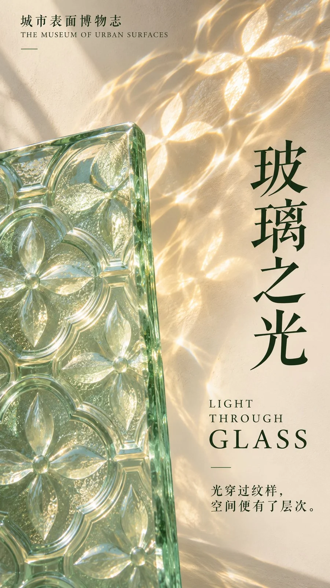

# Museum Poster Template: Let the Material Shape the Layout (9:16)

**中文标题：** 博物海报模板：让材料来决定构图（9:16）  
**ID:** `gi25-x-1683` · **Mode:** `generate`  
**Categories:** `poster-typography`  
**Tags:** `x-twitter`, `community`, `gpt-image-2.5`, `x-direct`, `zh`



### Museum Poster Template: Let the Material Shape the Layout (9:16)

```text
【海报主题】：
【核心材料或物件】：
【希望表达的材料特性】：
【画面文字】：可自行填写或根据主题生成
【主色调】：默认从材料本身提取
【画幅比例】：9:16

请创作一张具有成熟东亚艺术展览与博物馆策展美学的独立艺术海报，将日常材料、工艺或物件转化为具有艺术欣赏价值与文化传播价值的视觉作品。

核心设计原则：让材料创造构图，而不是让构图容纳材料。

深入研究主体最独特的物理特性、形态轮廓、表面纹理、色彩、光学表现或加工工艺，从中选择一种最有表达价值的特征，将其转化为整张海报的视觉组织机制。

例如，透明材料可以通过透射与折射光影组织画面；具有连续纹样的材料可以通过重复与拼接生成版式；具有丰富肌理的材料可以通过表面变化与细节密度形成构图；具有镂空结构的物件可以通过实体轮廓塑造负空间。

以上仅为设计方法示例，不得机械套用，应根据当前主体独立推导新的构图关系。

【构图与视觉层级】

建立一个鲜明、具有足够尺度的核心视觉主体，让观众在手机缩略图状态下也能快速辨认主题。

采用具有自然视觉动势的非对称构图，通过主体轮廓、尺度反差、自然裁切、疏密变化、光影延展或负空间形成完整的画面关系。

根据内容需要选择最贴切的视觉手法，不强行堆叠透视、穿插、遮挡及立体效果。

保持局部丰富、整体有序，允许大面积安静留白，使画面具有清晰的视觉重心与连续的阅读路径。

【字体与图文关系】

根据主体的轮廓、方向、视觉重量及自然留白决定文字的位置、尺度和排列方式。

中文采用具有文化艺术气质的现代宋体或明朝体，英文采用优雅的经典衬线字体。

通过字形宽窄、笔画粗细、字号反差、字距疏密及横竖排列，使文字与主体形成有意义的视觉呼应。

只保留必要的标题、副标题及具有实际意义的解释文字。所有关键文字准确、清晰、易于阅读，不强行填充留白。

【色彩与材质】

从材料自身提取主色、辅助色与背景色，建立具有内在联系的色彩体系。

整体色彩温润、克制、低饱和但保持充分的色彩浓度，具有高级艺术印刷品的视觉质感。

真实呈现材料的物理属性、表面肌理、实体厚度、光泽及自然受光关系，避免塑料感、廉价滤镜、过度做旧与不合理的CGI特效。
```

- **Recommended model:** `gpt-image-2.5-flare`
- **Settings:** _(defaults)_
- **Source:** [community](https://x.com/MrLarus/status/2125975286739304631) — @MrLarus
- **License note:** Original public X post; quoted with attribution — remix with attribution
- **Notes:** Collected directly from X; prompt posted as the author's own reply https://x.com/MrLarus/status/2125975286739304631 to https://x.com/MrLarus/status/2125975194116473302, which carries the images; GPT Image 2.5 is named in the reply; discovered via X search, prompt re-verified against the original X post via api.fxtwitter.com; verified=True; fill-in poster template posted as the author's public reply; the parent post carries the four example images; this post does not name a Flare/Sunburst variant; preview is image 1 of the parent
- **Preview:** `previews/gi25-x-1683.webp`
